# Admin Console Completeness Audit (`/dashboard/admin/*` vs. SRS Master v2.0 §10.9–10.13)

- **Audit Date:** 2026-10-20
- **Environment:** Next.js 15.2.6 (Turbopack) at `http://localhost:3000`, PostgreSQL 16 (`banabuild-pg` on `:5433`), authenticated as `admin@demo.com` (`RoleCode.USR_ADMIN` / `userType: "Admin"`).
- **Authoritative Spec:** `ConstructsHub-Requirements/BanahBuild ConstructsHub — Master SRS v2.0.docx` (§10.9, §10.9.1 `FR-CFG-01`..`FR-CFG-07`, §10.10, §10.11, §10.12 + §8.7 `FR-FIN-01`, §10.13, and cross-referenced §6.3 & §15.1–15.6).
- **Screenshots Directory:** [`docs/reviews/screenshots/`](file:///home/meqdad/My-Projects/Construct-Hub_Project/docs/reviews/screenshots)

---

## 1. Executive Summary & Verdict

> [!WARNING]
> **Verdict: The `/dashboard/admin/*` console set is NOT complete (~38% functional against SRS §10.9–10.13).**
> While 10 routes under `/dashboard/admin/*` exist and compile cleanly (`PROGRESS.md` previously marked item #10 as _"admin set complete"_), live browser walkthroughs against both the seeded database and populated test rows revealed **2 fatal runtime crashes when rows exist**, **1 PII/credential leak (`passwordHash`) in `GET /api/payouts`**, **3 dead detail-route links (`404 Not Found`)**, **2 literal no-op action buttons (`onClick={() => {}}`)**, **3 admin consoles missing from sidebar navigation**, **1 duplicate nested `DashboardShell` layout bug**, **2 permanently empty panels caused by querying the wrong table or `.catch()` fallback logic**, and **1 entire SRS console (§10.13 Content & Moderation) completely unbuilt (`404`)**.

### High-Level Route & SRS Coverage Matrix

| Route | SRS Section | Sidebar Link? | Seeded DB State | Non-Empty Row State | Status |
|---|---|---|---|---|---|
| [`/dashboard/admin`](file:///home/meqdad/My-Projects/Construct-Hub_Project/waquor/src/app/dashboard/admin/page.tsx) | §10.9 Super Admin | Yes (`Overview`) | 2/4 tables empty; Health Monitor is a static dashed box; Audit Trail empty | Renders, but queries `User.isVerified` instead of `VerificationCase` and `AuditLog` (0 rows) instead of `AuditEvent` (21+ rows) | **Partial / Buggy** |
| [`/dashboard/admin/users`](file:///home/meqdad/My-Projects/Construct-Hub_Project/waquor/src/app/dashboard/admin/users/page.tsx) | §10.9 Super Admin | Yes (`User Registry`) | 8 seeded users rendered | Clicking `View →` navigates to `/dashboard/admin/users/[id]` → **404 Not Found** | **Dead Action Links** |
| [`/dashboard/admin/verifications`](file:///home/meqdad/My-Projects/Construct-Hub_Project/waquor/src/app/dashboard/admin/verifications/page.tsx) | §10.11 Verification | Yes (`Verifications`) | Empty (`0` pending; all 8 seed users have `isVerified: true`) | **SERVER CRASH** (`Event handlers cannot be passed to Client Component props`) because `Approve`/`Reject` pass `onClick={() => {}}` inside a Server Component | **Broken / Crashes** |
| [`/dashboard/admin/disputes`](file:///home/meqdad/My-Projects/Construct-Hub_Project/waquor/src/app/dashboard/admin/disputes/page.tsx) | §10.10 Support / §7.6 | Yes (`Disputes`) | Empty (`0` disputes) | Clicking `Review →` navigates to `/dashboard/admin/disputes/[id]` → **404 Not Found** | **Empty / Dead Links** |
| [`/dashboard/admin/support`](file:///home/meqdad/My-Projects/Construct-Hub_Project/waquor/src/app/dashboard/admin/support/page.tsx) | §10.10 Support | Yes (`Support`) | Empty (`0` support tickets) | Clicking `Open →` navigates to `/dashboard/admin/support/[id]` → **404 Not Found** | **Empty / Dead Links** |
| [`/dashboard/admin/audit`](file:///home/meqdad/My-Projects/Construct-Hub_Project/waquor/src/app/dashboard/admin/audit/page.tsx) | §10.9 / §15.5 Audit | Yes (`Audit Log`) | **Permanently empty (`0` rows)** despite 21+ `AuditEvent` rows in DB | Reads `prisma.auditLog` (`0` rows) while `lib/security.ts` writes to `prisma.auditEvent` (`21+` rows) | **Broken (Wrong Table)** |
| [`/dashboard/admin/config`](file:///home/meqdad/My-Projects/Construct-Hub_Project/waquor/src/app/dashboard/admin/config/page.tsx) | §10.9.1 Config (`FR-CFG-01..07`) | Yes (`Config`) | Commission Slabs (3 rows) work; **Feature Flags panel is blank**; **Platform Settings are static text** | Feature Flags empty array `[]` does not trigger `.catch()` fallback; no UI to create flags; missing `FR-CFG-01..07` validation/effective-dating/cache | **Partial (~30%)** |
| [`/dashboard/admin/finance`](file:///home/meqdad/My-Projects/Construct-Hub_Project/waquor/src/app/dashboard/admin/finance/page.tsx) | §10.12 Finance + §8.7 `FR-FIN-01` | **No** (unreachable from UI) | Duplicate nested sidebar/header (`dir="rtl"`); Payouts & Chargebacks empty; Reconciliation shows `SAR 0.00` | **CLIENT CRASH** (`Objects are not valid as a React child`) when any `Payout` exists (`r.recipient` is a Prisma `User` object, not string); Chargebacks crash on `r.status.toUpperCase()` | **Broken / Crashes** |
| [`/dashboard/admin/analytics`](file:///home/meqdad/My-Projects/Construct-Hub_Project/waquor/src/app/dashboard/admin/analytics/page.tsx) | §10.9 / §15.6 Telemetry | **No** (unreachable from UI) | Route latency & Event boards empty until traffic hits instrumented routes | Populates after API traffic; `events.dau` is fetched from API but never rendered | **Functional (Unlinked)** |
| [`/dashboard/admin/search`](file:///home/meqdad/My-Projects/Construct-Hub_Project/waquor/src/app/dashboard/admin/search/page.tsx) | §6.3 Search Console | **No** (unreachable from UI) | Top/No-hit query tables & Synonyms table empty (`0` rows); Health tab works | Synonym `Add / replace` & `Delete` work end-to-end; Reindex & Clear Cache buttons work | **Functional (Unlinked)** |
| `/dashboard/admin/moderation` | §10.13 Content & Moderation | **No** | **404 Not Found** — route does not exist | Not implemented | **Missing (0%)** |

---

## 2. Inventory of Empty Consoles & Panels

### 2.1 Permanently Empty Panels (Caused by Code Bugs, Even When Data Exists)

1. **Audit Log Console ([`/dashboard/admin/audit`](file:///home/meqdad/My-Projects/Construct-Hub_Project/waquor/src/app/dashboard/admin/audit/page.tsx#L14-L18)) & Overview Audit Trail ([`/dashboard/admin`](file:///home/meqdad/My-Projects/Construct-Hub_Project/waquor/src/app/dashboard/admin/page.tsx#L88-L91))**
   - **Observed UI:** Shows `"📋 No audit entries yet — Administrative actions and security events will be recorded here."` (`0` rows), even immediately after logging in and exercising admin APIs.
   - **Root Cause (Split Audit Models):** [`waquor/prisma/schema.prisma`](file:///home/meqdad/My-Projects/Construct-Hub_Project/waquor/prisma/schema.prisma#L1016-L1052) defines **two** audit tables: `AuditLog` (`action`, `entityType`, `entityId`, `metadata`) and `AuditEvent` (`action`, `targetType`, `targetId`, `ip`, `userAgent`, `meta`).
   - [`auditLog()` in `lib/security.ts`](file:///home/meqdad/My-Projects/Construct-Hub_Project/waquor/lib/security.ts#L102-L120) (called by auth login, verification review, disputes, payouts, etc.) writes exclusively to **`prisma.auditEvent`** (which has **21+ rows** in the database).
   - Meanwhile, [`/dashboard/admin/audit/page.tsx`](file:///home/meqdad/My-Projects/Construct-Hub_Project/waquor/src/app/dashboard/admin/audit/page.tsx#L14), [`/dashboard/admin/page.tsx`](file:///home/meqdad/My-Projects/Construct-Hub_Project/waquor/src/app/dashboard/admin/page.tsx#L88), and [`GET /api/admin/audit`](file:///home/meqdad/My-Projects/Construct-Hub_Project/waquor/src/app/api/admin/audit/route.ts#L17) read exclusively from **`prisma.auditLog`** (`0` rows).

2. **Feature Flags Card on Configuration Console ([`/dashboard/admin/config`](file:///home/meqdad/My-Projects/Construct-Hub_Project/waquor/src/app/dashboard/admin/config/page.tsx#L31-L45))**
   - **Observed UI:** The `"Feature Flags"` card renders completely empty (zero rows, zero buttons).
   - **Root Cause:** `prisma/seed.ts` seeds 3 `CommissionSlab` rows (`Catalogue=5%`, `Projects=8%`, `Logistics=6%`) but **0 `FeatureFlag` rows**. `GET /api/admin/config` returns `200 OK` with `{ commissions: [...], flags: [] }`. In [`config/page.tsx` lines 35–44](file:///home/meqdad/My-Projects/Construct-Hub_Project/waquor/src/app/dashboard/admin/config/page.tsx#L35-L44), the default flags (`ai_estimator`, `bim_viewer`, `zatca_einvoice`, `escrow_auto_release`, `driver_live_tracking`, `social_auto_post`) are placed inside `.catch(() => { ... })`, which never runs when the API succeeds with `flags: []`. There is also no `"Add Flag"` button in the UI.

3. **Platform Health Monitor on Overview ([`/dashboard/admin`](file:///home/meqdad/My-Projects/Construct-Hub_Project/waquor/src/app/dashboard/admin/page.tsx#L173-L178))**
   - **Observed UI:** Renders an empty `h-48` dashed placeholder box: `"Live health telemetry integration point (sessions, latency, errors, uptime)"`.
   - **Root Cause:** Hardcoded static `
` placeholder; never wired to [`GET /api/health`](file:///home/meqdad/My-Projects/Construct-Hub_Project/waquor/src/app/api/health/route.ts), [`GET /api/admin/analytics/routes`](file:///home/meqdad/My-Projects/Construct-Hub_Project/waquor/src/app/api/admin/analytics/routes/route.ts), or [`GET /api/admin/search/health`](file:///home/meqdad/My-Projects/Construct-Hub_Project/waquor/src/app/api/admin/search/health/route.ts).

### 2.2 Empty Consoles in Default Seeded State (`prisma/seed.ts`)

Because [`waquor/prisma/seed.ts`](file:///home/meqdad/My-Projects/Construct-Hub_Project/waquor/prisma/seed.ts) marks all 8 demo users `isVerified: true` and does not seed `VerificationCase`, `Dispute`, `SupportTicket`, `Payout`, `EscrowHold`, `LedgerEntry`, `ReturnCase`, `SearchEvent`, `SearchSynonym`, `RouteMetric`, or `Announcement`, the following consoles/tabs render empty out of the box:

- [`/dashboard/admin`](file:///home/meqdad/My-Projects/Construct-Hub_Project/waquor/src/app/dashboard/admin/page.tsx) — **Verification Queue** (`No records found.`) and **Support Ticket Center** (`No records found.`).
- [`/dashboard/admin/verifications`](file:///home/meqdad/My-Projects/Construct-Hub_Project/waquor/src/app/dashboard/admin/verifications/page.tsx) — **Pending Verifications** (`"✅ All caught up! No pending KYC verifications at this time."`).
- [`/dashboard/admin/disputes`](file:///home/meqdad/My-Projects/Construct-Hub_Project/waquor/src/app/dashboard/admin/disputes/page.tsx) — **Disputes Queue** (`"⚖️ No disputes — No disputes have been filed on the platform."`).
- [`/dashboard/admin/support`](file:///home/meqdad/My-Projects/Construct-Hub_Project/waquor/src/app/dashboard/admin/support/page.tsx) — **Support Tickets Queue** (`"🎫 No support tickets — The support queue is clear."`).
- [`/dashboard/admin/finance`](file:///home/meqdad/My-Projects/Construct-Hub_Project/waquor/src/app/dashboard/admin/finance/page.tsx) — **Payouts Queue** (`"No payouts found."`), **Chargeback Log** (`"No chargebacks found."`), and **Reconciliation** (all 8 cards show `SAR 0.00`).
- [`/dashboard/admin/analytics`](file:///home/meqdad/My-Projects/Construct-Hub_Project/waquor/src/app/dashboard/admin/analytics/page.tsx) — **Route Latency** (`"No samples yet — exercise the API to populate."`) and **Top Events** (`"No events yet."`) until instrumented endpoints are called.
- [`/dashboard/admin/search`](file:///home/meqdad/My-Projects/Construct-Hub_Project/waquor/src/app/dashboard/admin/search/page.tsx) — **Top queries** (`"No searches logged yet."`), **No-hit queries** (`"Zero dead-ends recorded."`), and **Active synonyms** (`"No synonyms configured."`).

---

## 3. Dead Buttons, Dead Links (404s), Runtime Crashes & Bugs

### 3.1 Summary Table of Broken Interactive Elements & Runtime Bugs

| Severity | Console / File | Element / Trigger | Observed Failure | Root Cause |
|---|---|---|---|---|
| **P0 — Crash** | [`/dashboard/admin/verifications`](file:///home/meqdad/My-Projects/Construct-Hub_Project/waquor/src/app/dashboard/admin/verifications/page.tsx#L81-L92) | Page load when any user has `isVerified: false` | `Application error: a server-side exception has occurred` (`Error: Event handlers cannot be passed to Client Component props`) | Server Component passes `<button onClick={() => {}}>` inside `DataTable` `columns[].render` |
| **P0 — Crash** | [`/dashboard/admin/finance`](file:///home/meqdad/My-Projects/Construct-Hub_Project/waquor/src/app/dashboard/admin/finance/page.tsx#L217-L271) | Page load or filter when any `Payout` row exists | `Application error: a client-side exception has occurred` (`Objects are not valid as a React child (found: object with keys {id, email, passwordHash, ...})`) | [`GET /api/payouts`](file:///home/meqdad/My-Projects/Construct-Hub_Project/waquor/src/app/api/payouts/route.ts#L66) returns `recipient` as a nested Prisma `User` object, while [`finance/page.tsx`](file:///home/meqdad/My-Projects/Construct-Hub_Project/waquor/src/app/dashboard/admin/finance/page.tsx#L271) renders `{r.recipient}` directly and calls `p.recipient.toLowerCase()` |
| **P0 — PII / Sec** | [`GET /api/payouts`](file:///home/meqdad/My-Projects/Construct-Hub_Project/waquor/src/app/api/payouts/route.ts#L64-L69) | Fetching payouts in Finance console | Leaks `recipient.passwordHash` and full `User`/`Profile` record in JSON response | Uses `include: { recipient: { include: { profile: true } } }` instead of `select` |
| **P0 — Crash** | [`/dashboard/admin/finance`](file:///home/meqdad/My-Projects/Construct-Hub_Project/waquor/src/app/dashboard/admin/finance/page.tsx#L76-L78) | Switching to `Chargeback Log` tab when a refunded `EscrowHold` exists | `TypeError: Cannot read properties of undefined (reading 'toUpperCase')` | [`GET /api/admin/finance/chargebacks`](file:///home/meqdad/My-Projects/Construct-Hub_Project/waquor/src/app/api/admin/finance/chargebacks/route.ts#L105-L115) omits `status` on `refundedEscrows`, and returns `raisedBy`/`recipient`/`payer` + `failureReason`/`frozenReason` + `requestedAt`/`refundedAt` instead of `party`/`reason`/`createdAt` expected by the UI |
| **P1 — Dead Btn** | [`/dashboard/admin/verifications`](file:///home/meqdad/My-Projects/Construct-Hub_Project/waquor/src/app/dashboard/admin/verifications/page.tsx#L83-L91) | `Approve` & `Reject` buttons | Literal no-op (`onClick={() => {}}`); never calls `/api/verifications/[caseId]` or `/api/admin/dashboard` | Stubbed handler left in JSX |
| **P1 — 404 Link** | [`/dashboard/admin/users`](file:///home/meqdad/My-Projects/Construct-Hub_Project/waquor/src/app/dashboard/admin/users/page.tsx#L71) | `View →` link on all 8 user rows | Navigates to `/dashboard/admin/users/<id>` → **404 Not Found** | No `waquor/src/app/dashboard/admin/users/[id]/page.tsx` route exists |
| **P1 — 404 Link** | [`/dashboard/admin/disputes`](file:///home/meqdad/My-Projects/Construct-Hub_Project/waquor/src/app/dashboard/admin/disputes/page.tsx#L73) | `Review →` link on dispute rows | Navigates to `/dashboard/admin/disputes/<id>` → **404 Not Found** | No `waquor/src/app/dashboard/admin/disputes/[id]/page.tsx` route exists |
| **P1 — 404 Link** | [`/dashboard/admin/support`](file:///home/meqdad/My-Projects/Construct-Hub_Project/waquor/src/app/dashboard/admin/support/page.tsx#L75) | `Open →` link on support ticket rows | Navigates to `/dashboard/admin/support/<id>` → **404 Not Found** | No `waquor/src/app/dashboard/admin/support/[id]/page.tsx` route exists |
| **P1 — Nav** | [`DashboardShell.tsx`](file:///home/meqdad/My-Projects/Construct-Hub_Project/waquor/components/dashboard/DashboardShell.tsx#L103-L112) | Admin sidebar navigation (`NAV_BY_ROLE.USR_ADMIN`) | **Finance** (`/dashboard/admin/finance`), **Analytics** (`/dashboard/admin/analytics`), and **Search Console** (`/dashboard/admin/search`) have **no links anywhere in the UI** | Missing entries in `NAV_BY_ROLE.USR_ADMIN` |
| **P1 — Layout** | [`/dashboard/admin/finance`](file:///home/meqdad/My-Projects/Construct-Hub_Project/waquor/src/app/dashboard/admin/finance/page.tsx#L425-L434) | Entire Finance Console layout | Renders **two nested sidebars and two top bars side-by-side** and forces `dir="rtl"` even when locale is English (`ltr`) | [`dashboard/layout.tsx`](file:///home/meqdad/My-Projects/Construct-Hub_Project/waquor/src/app/dashboard/layout.tsx#L28) already wraps pages in `<DashboardShell>`, and `finance/page.tsx` wraps itself in a second `<DashboardShell>` + `
` |
| **P1 — Dead Filter** | [`/dashboard/admin/finance`](file:///home/meqdad/My-Projects/Construct-Hub_Project/waquor/src/app/dashboard/admin/finance/page.tsx#L194-L206) | Chargeback Log `dateFrom` & `dateTo` date pickers | Selecting dates triggers a fetch, but results are never filtered by date | Neither [`GET /api/admin/finance/chargebacks`](file:///home/meqdad/My-Projects/Construct-Hub_Project/waquor/src/app/api/admin/finance/chargebacks/route.ts) nor `filteredChargebacks` in `finance/page.tsx` reads `dateFrom`/`dateTo` |
| **P1 — Missing UI** | [`/dashboard/admin/finance`](file:///home/meqdad/My-Projects/Construct-Hub_Project/waquor/src/app/dashboard/admin/finance/page.tsx#L103) | Payouts `org` filter | `payoutFilters.org` exists in React state, is sent to `/api/payouts`, and is claimed in `PROGRESS.md`, but **no input/dropdown is rendered in the DOM** | Only 3 inputs (`status` select, `dateFrom`, `dateTo`) + search box exist in the filter grid |
| **P1 — Broken Stat** | [`/dashboard/admin/finance`](file:///home/meqdad/My-Projects/Construct-Hub_Project/waquor/src/app/dashboard/admin/finance/page.tsx#L619) | Reconciliation tab `Payouts Pending` StatCard | Always displays `SAR 0.00` even when pending payouts exist | Reads `p?._sum?.amount`, whereas [`GET /api/admin/finance/reconciliation`](file:///home/meqdad/My-Projects/Construct-Hub_Project/waquor/src/app/api/admin/finance/reconciliation/route.ts#L56-L60) maps items to `{ status, totalAmount, count }` |
| **P2 — Broken Pager** | [`/dashboard/admin/finance`](file:///home/meqdad/My-Projects/Construct-Hub_Project/waquor/src/app/dashboard/admin/finance/page.tsx#L533-L557) | Payouts & Chargebacks pagination controls | Pagination bar never renders (`payouts.length > payoutPageSize` is `false` when API returns at most `pageSize = 20` items); Chevron icons are also inverted | Checks `payouts.length > 20` instead of `totalCount > 20` |
| **P2 — Nav Highlight** | [`DashboardShell.tsx`](file:///home/meqdad/My-Projects/Construct-Hub_Project/waquor/components/dashboard/DashboardShell.tsx#L148) | Sidebar active state on any `/dashboard/admin/*` sub-route | `Overview` (`/dashboard/admin`) stays highlighted alongside the active sub-console | `pathname?.startsWith(item.href + '/')` matches `/dashboard/admin` for all child routes |
| **P2 — CSS Dimming** | [`src/app/globals.css`](file:///home/meqdad/My-Projects/Construct-Hub_Project/waquor/src/app/globals.css#L44-L54) | All `/dashboard/*` pages | Main content area is darkened by a `rgba(0,0,0,0.3)` overlay while sidebar (`z-40`) and header (`z-30`) remain bright | `body::before` has `position: fixed; z-index: 0` while `<main>` in `DashboardShell` has no `relative z-10` |

---

## 4. Console-by-Console Walkthrough & Screenshots

### 4.1 `/dashboard/admin` — Super Admin Overview
- **Source:** [`waquor/src/app/dashboard/admin/page.tsx`](file:///home/meqdad/My-Projects/Construct-Hub_Project/waquor/src/app/dashboard/admin/page.tsx)
- **Screenshot:** 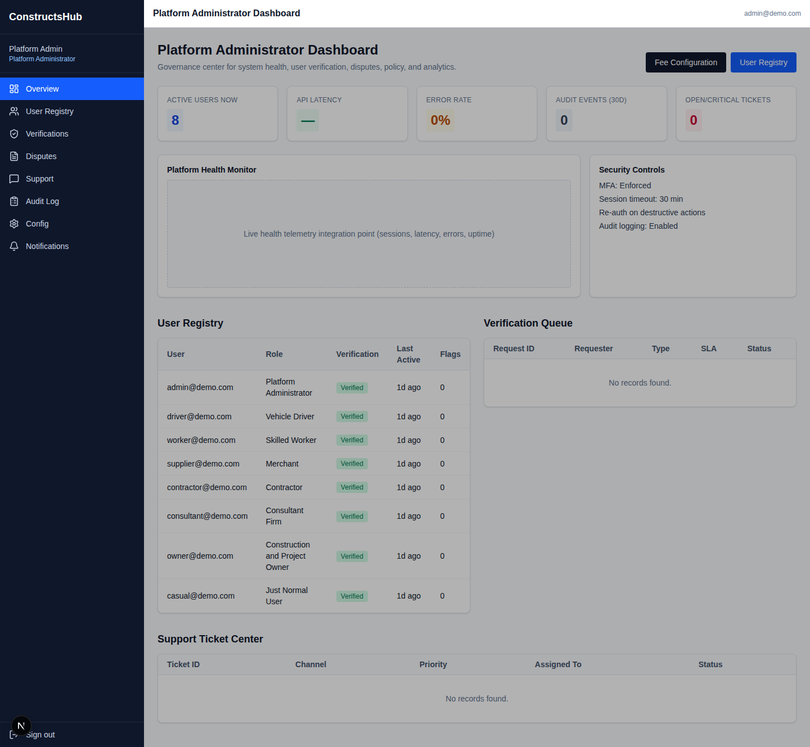
- **What Works:**
  - KPI stat cards (`Total Users: 8`, `Active Orders: 1`, `Platform GMV: 2,875 SAR`, `Open Disputes: 0`, `Support Queue: 0`) query Prisma.
  - `User Registry` table displays the 8 seeded users with roles (`Admin`, `Casual`, `Consultant`, `Contractor`, `Driver`, `Owner`, `Supplier`, `Worker`) and `Verified` badges.
  - `Role & Permission Matrix` and `Commission Slabs` cards render.
- **What Is Empty, Fake, or Broken:**
  - **Verification Queue table:** Empty (`No records found.`). Queries `recentUsers.filter(u => !u.isVerified)` and synthesizes fake IDs (`VER-2100 + idx`) instead of querying `prisma.verificationCase`.
  - **Support Ticket Center table:** Empty (`No records found.`).
  - **Platform Health Monitor:** Empty dashed box (`"Live health telemetry integration point (sessions, latency, errors, uptime)"`).
  - **Audit Trail card:** Empty (`No audit entries yet`) because it queries `prisma.auditLog` instead of `prisma.auditEvent`.
  - **Hardcoded / Fake Metrics:** Lines 124–125 compute `const apiLatency = recentTickets.length > 0 ? '143 ms' : '—'` and `const errorRate = recentTickets.length > 0 ? '1.1%' : '0%'` — fake strings tied to whether support tickets exist!
  - **Hardcoded Security Controls:** Card claims `MFA: Enforced (Admin + Finance)` and `Session timeout: 30 min`, which are static strings not backed by [`lib/auth.ts`](file:///home/meqdad/My-Projects/Construct-Hub_Project/waquor/lib/auth.ts) (which uses 8-hour JWT sessions and has no MFA implementation).

---

### 4.2 `/dashboard/admin/users` — User Registry
- **Source:** [`waquor/src/app/dashboard/admin/users/page.tsx`](file:///home/meqdad/My-Projects/Construct-Hub_Project/waquor/src/app/dashboard/admin/users/page.tsx)
- **Screenshots:**
  - 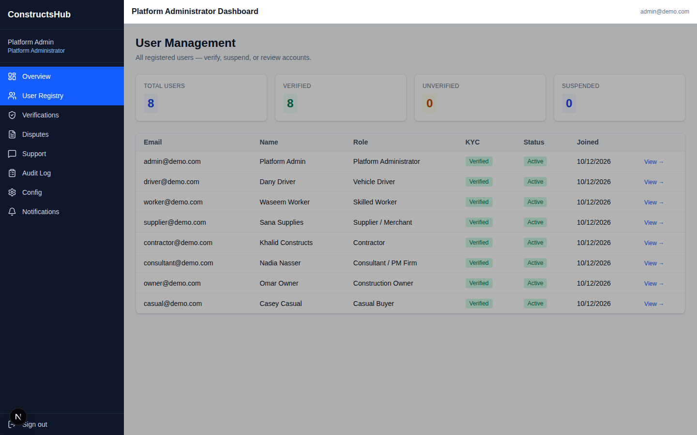
  - 
- **What Works:**
  - Renders 4 StatCards (`Total Users: 8`, `Verified: 8`, `Pending KYC: 0`, `Active: 8`) and the 8 seeded users.
- **What Is Broken / Missing vs. SRS §10.9:**
  - **Dead `View →` Links (404):** Every row's `View →` link ([line 71](file:///home/meqdad/My-Projects/Construct-Hub_Project/waquor/src/app/dashboard/admin/users/page.tsx#L71)) points to `/dashboard/admin/users/${r.id}`, which returns **404 Not Found** (no `[id]/page.tsx` exists).
  - **No Admin Actions:** Although [`POST /api/admin/dashboard`](file:///home/meqdad/My-Projects/Construct-Hub_Project/waquor/src/app/api/admin/dashboard/route.ts) supports `suspend-user`, `activate-user`, and `change-role`, the UI has no buttons or controls to suspend/ban/reactivate users, change roles, search/filter users, or view organization memberships.

---

### 4.3 `/dashboard/admin/verifications` — KYC Verification Queue
- **Source:** [`waquor/src/app/dashboard/admin/verifications/page.tsx`](file:///home/meqdad/My-Projects/Construct-Hub_Project/waquor/src/app/dashboard/admin/verifications/page.tsx)
- **Screenshot:** 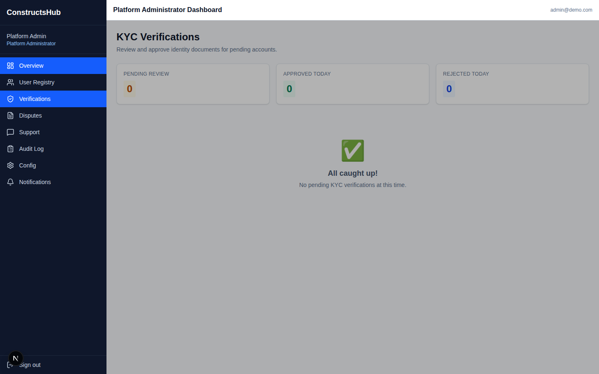
- **What Works:**
  - Renders page header and 3 StatCards when `rows.length === 0`.
- **What Is Empty or Broken vs. SRS §10.11:**
  - **Empty in Seeded DB:** All 8 seeded users have `isVerified: true`, and `0` `VerificationCase` rows exist.
  - **Crashes Server-Side When Pending Rows Exist:** Because `verifications/page.tsx` is a Server Component and passes `onClick={() => {}}` on the `Approve` and `Reject` buttons ([lines 83–91](file:///home/meqdad/My-Projects/Construct-Hub_Project/waquor/src/app/dashboard/admin/verifications/page.tsx#L83-L91)), creating an unverified user immediately crashes `/dashboard/admin/verifications` with:
    `Error: Event handlers cannot be passed to Client Component props. <button className=... onClick={function onClick} children=...>`
  - **Dead No-Op Buttons:** Even if converted to a Client Component, `onClick={() => {}}` is a literal no-op that never calls [`PATCH /api/verifications/[caseId]`](file:///home/meqdad/My-Projects/Construct-Hub_Project/waquor/src/app/api/verifications/%5BcaseId%5D/route.ts) or [`POST /api/admin/dashboard`](file:///home/meqdad/My-Projects/Construct-Hub_Project/waquor/src/app/api/admin/dashboard/route.ts).
  - **Hardcoded StatCards:** `Approved Today` and `Rejected Today` ([lines 51–52](file:///home/meqdad/My-Projects/Construct-Hub_Project/waquor/src/app/dashboard/admin/verifications/page.tsx#L51-L52)) are hardcoded to `value="0"`.
  - **Wrong Model Queried:** Queries `prisma.user.findMany({ where: { isVerified: false } })` instead of `prisma.verificationCase.findMany`, ignoring the dedicated `VerificationCase` model (`entityType`, `entityId`, `documentUrls`, `status`, `notes`, `reviewedById`, `expiresAt`).

---

### 4.4 `/dashboard/admin/disputes` — Disputes Queue
- **Source:** [`waquor/src/app/dashboard/admin/disputes/page.tsx`](file:///home/meqdad/My-Projects/Construct-Hub_Project/waquor/src/app/dashboard/admin/disputes/page.tsx)
- **Screenshot:** 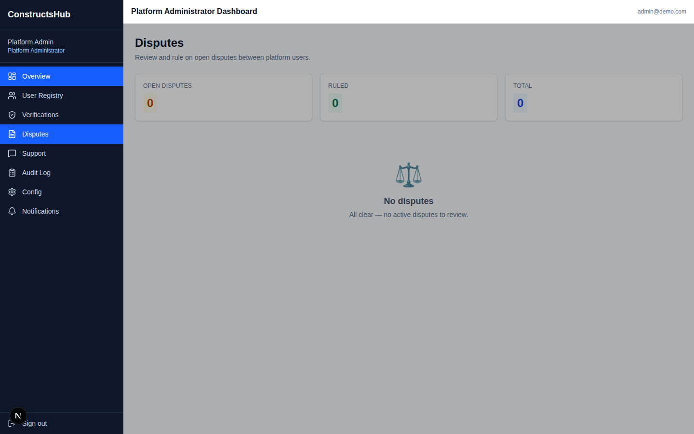
- **What Works:**
  - Queries `prisma.dispute.findMany` and computes `Open Disputes`, `Ruled`, and `Total` StatCards.
- **What Is Empty or Broken vs. SRS §10.10 / §7.6:**
  - **Empty in Seeded DB:** `0` disputes seeded.
  - **Dead `Review →` Links (404):** When a `Dispute` row exists, the `Action` column renders `<a href="/dashboard/admin/disputes/${r.id}">Review →</a>` ([line 73](file:///home/meqdad/My-Projects/Construct-Hub_Project/waquor/src/app/dashboard/admin/disputes/page.tsx#L73)), which returns **404 Not Found**.
  - **Unwired Backend Ruling API:** [`PATCH /api/disputes/[disputeId]`](file:///home/meqdad/My-Projects/Construct-Hub_Project/waquor/src/app/api/disputes/%5BdisputeId%5D/route.ts) implements dispute ruling and escrow release/refund (`RELEASE_TO_PAYEE`, `REFUND_TO_PAYER`, `SPLIT`), but no admin UI calls it.

---

### 4.5 `/dashboard/admin/support` — Support Tickets Workspace
- **Source:** [`waquor/src/app/dashboard/admin/support/page.tsx`](file:///home/meqdad/My-Projects/Construct-Hub_Project/waquor/src/app/dashboard/admin/support/page.tsx)
- **Screenshot:** 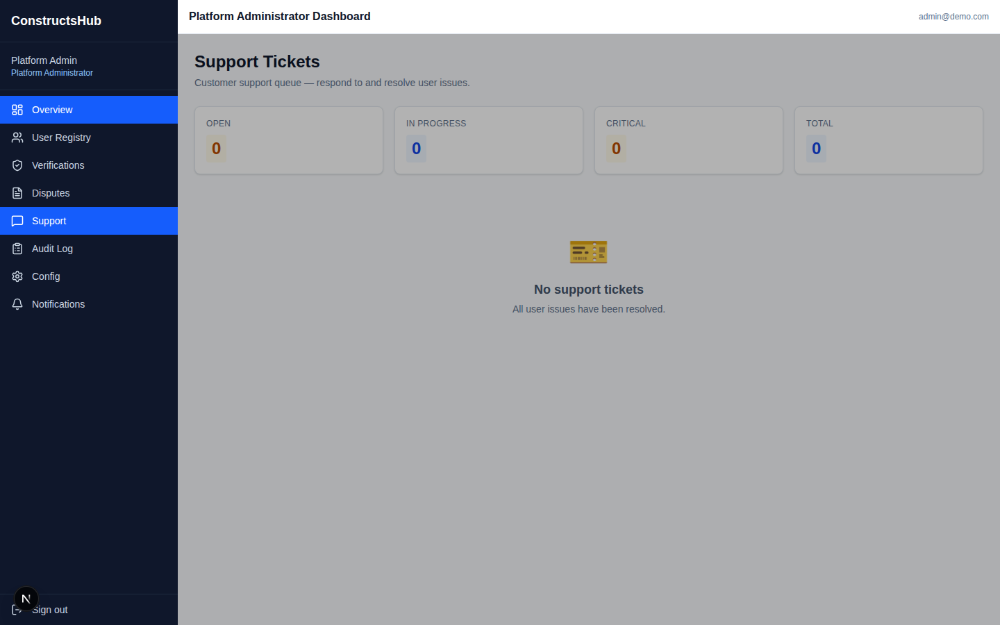
- **What Works:**
  - Queries `prisma.supportTicket.findMany` and computes `Open`, `In Progress`, `Critical`, and `Total` StatCards.
- **What Is Empty or Broken vs. SRS §10.10:**
  - **Empty in Seeded DB:** `0` support tickets seeded.
  - **Dead `Open →` Links (404):** When a `SupportTicket` row exists, the `Action` column renders `<a href="/dashboard/admin/support/${r.id}">Open →</a>` ([line 75](file:///home/meqdad/My-Projects/Construct-Hub_Project/waquor/src/app/dashboard/admin/support/page.tsx#L75)), which returns **404 Not Found**.
  - **Missing SRS §10.10 Capabilities:** No ticket detail/reply view, no Unified Customer Timeline (orders, bids, projects, chats, trips, payouts, audit events), no read-only impersonation (`View as User` with watermark and audit entry), no safe intervention actions (resend OTP/invoice, re-trigger failed webhook, extend escrow timer), and no canned responses.

---

### 4.6 `/dashboard/admin/audit` — Audit Log Console
- **Source:** [`waquor/src/app/dashboard/admin/audit/page.tsx`](file:///home/meqdad/My-Projects/Construct-Hub_Project/waquor/src/app/dashboard/admin/audit/page.tsx)
- **Screenshot:** 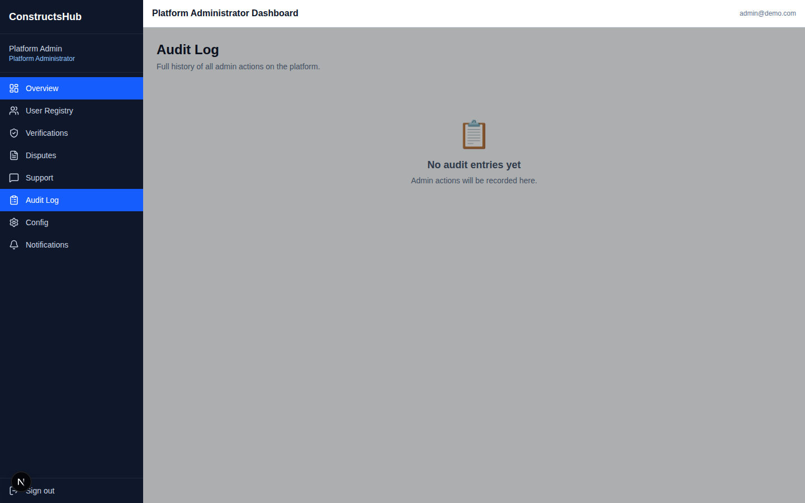
- **What Is Broken vs. SRS §10.9 / §15.5:**
  - **Permanently Empty (`0` entries):** Queries `prisma.auditLog.findMany` (`0` rows) while [`auditLog()` in `lib/security.ts`](file:///home/meqdad/My-Projects/Construct-Hub_Project/waquor/lib/security.ts#L102-L120) writes to `prisma.auditEvent` (`21+` rows).
  - **No Search, Filter, or Export:** Even if wired to `prisma.auditEvent`, the page is a static 200-row table with no actor/action/entity/date filters and no CSV/JSON export.

---

### 4.7 `/dashboard/admin/config` — Platform Configuration Registry
- **Source:** [`waquor/src/app/dashboard/admin/config/page.tsx`](file:///home/meqdad/My-Projects/Construct-Hub_Project/waquor/src/app/dashboard/admin/config/page.tsx)
- **Screenshot:** 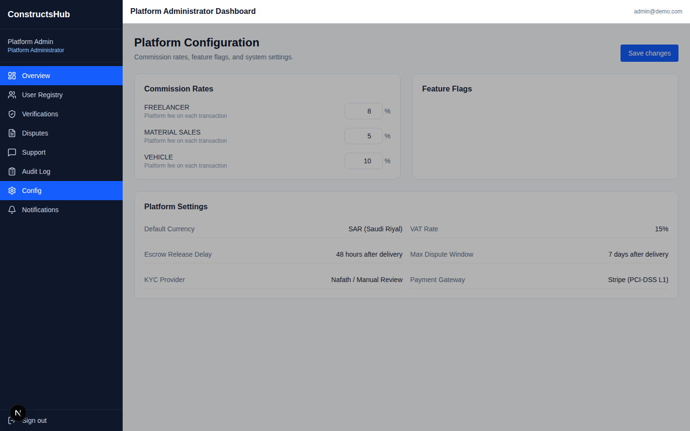
- **What Works:**
  - `Commission Slabs` card loads the 3 seeded slabs (`Catalogue: 5%`, `Projects: 8%`, `Logistics: 6%`), allows editing percentages, and saves via `POST /api/admin/config`.
- **What Is Empty or Broken vs. SRS §10.9.1 (`FR-CFG-01`..`FR-CFG-07`):**
  - **Feature Flags Card Is Blank:** Because `GET /api/admin/config` returns `flags: []` (0 rows in `FeatureFlag` table), the `.catch()` fallback defaults in [`config/page.tsx` lines 35–44](file:///home/meqdad/My-Projects/Construct-Hub_Project/waquor/src/app/dashboard/admin/config/page.tsx#L35-L44) never execute, leaving the Feature Flags card completely empty with no way to add flags.
  - **Platform Settings Card Is Non-Editable Static Text:** The 6 settings (`Default Currency: SAR`, `VAT Rate: 15% (ZATCA)`, `Escrow Release Delay: 7 days after delivery`, `Max Dispute Window: 14 days`, `KYC Provider: Nafath / Manual Review`, `Payment Gateway: Stripe + Mada + Apple Pay`) are hardcoded JSX strings ([lines 147–156](file:///home/meqdad/My-Projects/Construct-Hub_Project/waquor/src/app/dashboard/admin/config/page.tsx#L147-L156)) with no inputs, no database persistence, and no API backing.

---

### 4.8 `/dashboard/admin/finance` — Finance Console
- **Source:** [`waquor/src/app/dashboard/admin/finance/page.tsx`](file:///home/meqdad/My-Projects/Construct-Hub_Project/waquor/src/app/dashboard/admin/finance/page.tsx)
- **Screenshots:**
  - 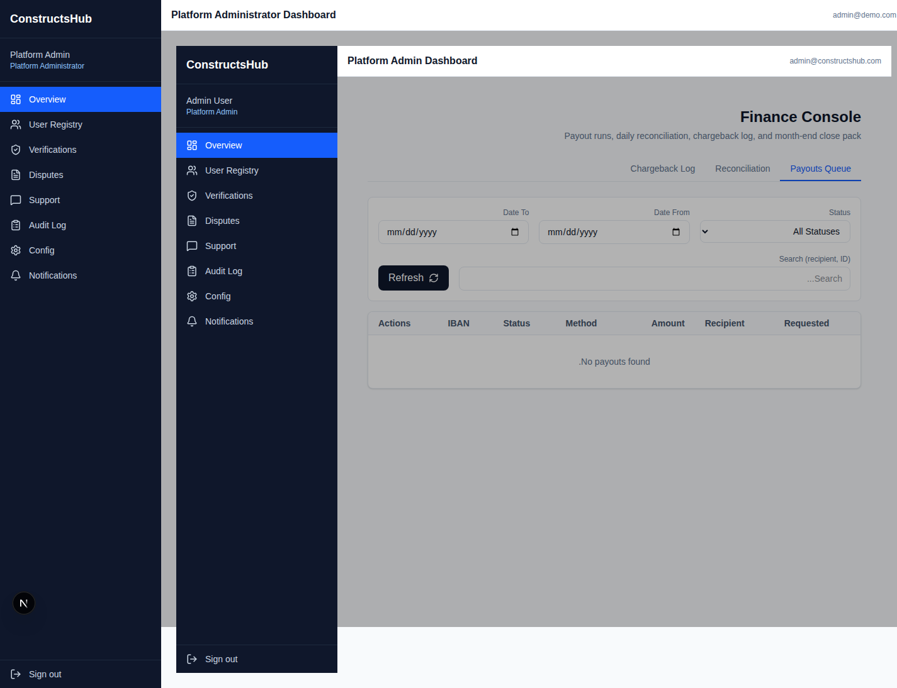
  - 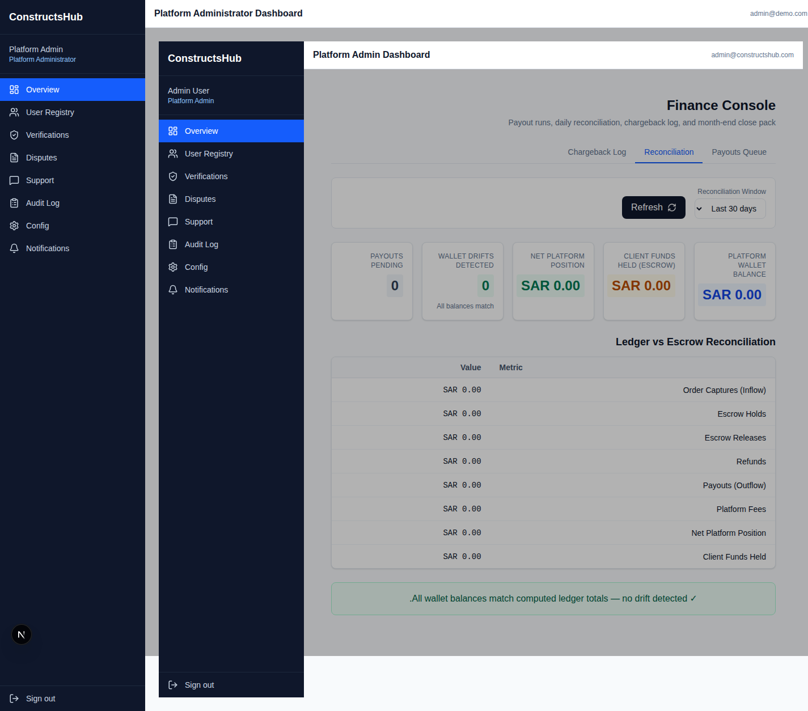
  - 
- **What Works:**
  - Tab switching (`Payouts Queue`, `Reconciliation`, `Chargeback Log`) and Reconciliation balance cards (`Total Ledger Balance: SAR 0.00`, `Total Escrow Held: SAR 0.00`, `Balance Drift: SAR 0.00 — Balanced ✓`) render when the database has 0 payouts/chargebacks.
- **What Is Broken vs. SRS §10.12 & §8.7 (`FR-FIN-01`):**
  1. **Unreachable from Sidebar:** Not listed in `NAV_BY_ROLE.USR_ADMIN` in [`DashboardShell.tsx`](file:///home/meqdad/My-Projects/Construct-Hub_Project/waquor/components/dashboard/DashboardShell.tsx#L103-L112).
  2. **Duplicate Nested `DashboardShell` + Forced RTL:** [`finance/page.tsx` lines 425–434](file:///home/meqdad/My-Projects/Construct-Hub_Project/waquor/src/app/dashboard/admin/finance/page.tsx#L425-L434) wraps itself in a second `<DashboardShell>` inside `dashboard/layout.tsx`'s `<DashboardShell>`, rendering **two sidebars and two top bars** and hardcoding `dir="rtl"` even in English mode.
  3. **Client Crash + `passwordHash` Leak When Payouts Exist:** [`GET /api/payouts`](file:///home/meqdad/My-Projects/Construct-Hub_Project/waquor/src/app/api/payouts/route.ts#L64-L69) includes the full Prisma `recipient` `User` object (including `passwordHash`), while [`finance/page.tsx` line 271](file:///home/meqdad/My-Projects/Construct-Hub_Project/waquor/src/app/dashboard/admin/finance/page.tsx#L271) renders `{r.recipient}` directly as a React child and calls `p.recipient.toLowerCase()` ([line 217](file:///home/meqdad/My-Projects/Construct-Hub_Project/waquor/src/app/dashboard/admin/finance/page.tsx#L217)), crashing React as soon as any `Payout` row exists.
  4. **Client Crash + Schema Mismatch on Chargebacks:** [`GET /api/admin/finance/chargebacks`](file:///home/meqdad/My-Projects/Construct-Hub_Project/waquor/src/app/api/admin/finance/chargebacks/route.ts) returns `raisedBy`/`recipient`/`payer` (not `party`), `failureReason`/`frozenReason` (not `reason`), `requestedAt`/`refundedAt` (not `createdAt`), and omits `status` on `refundedEscrows` (crashing `getStatusTone(r.status)` at [line 77](file:///home/meqdad/My-Projects/Construct-Hub_Project/waquor/src/app/dashboard/admin/finance/page.tsx#L77)).
  5. **Dead Date Filters & Missing Org Filter Input:** `dateFrom`/`dateTo` on Chargebacks are ignored by both API and client; `payoutFilters.org` has no UI control; `Payouts Pending` StatCard reads `_sum.amount` instead of `totalAmount`.

---

### 4.9 `/dashboard/admin/analytics` — Platform Analytics & Telemetry
- **Source:** [`waquor/src/app/dashboard/admin/analytics/page.tsx`](file:///home/meqdad/My-Projects/Construct-Hub_Project/waquor/src/app/dashboard/admin/analytics/page.tsx)
- **Screenshot:** 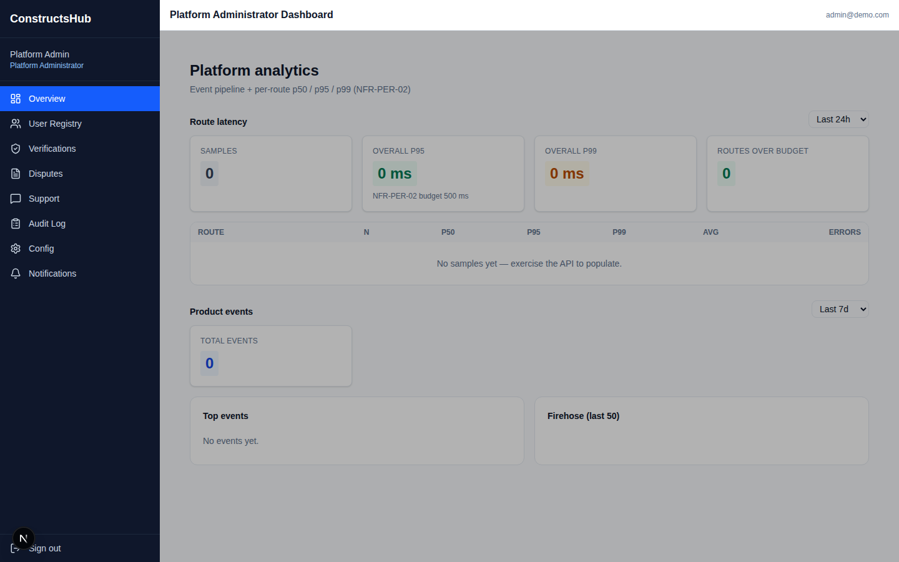
- **What Works:**
  - Time window buttons (`1h`, `24h`, `7d`, `30d` for routes; `7d`, `30d`, `90d` for events) trigger live fetches to `/api/admin/analytics/routes` and `/api/admin/analytics/events`.
  - Highlights routes exceeding the `500 ms` `NFR-PER-02` p95 target.
- **Gaps:**
  - **Missing from Sidebar Navigation** in [`DashboardShell.tsx`](file:///home/meqdad/My-Projects/Construct-Hub_Project/waquor/components/dashboard/DashboardShell.tsx#L103-L112).
  - **Empty in Seeded DB** until instrumented routes are exercised.
  - `events.dau` is returned by `/api/admin/analytics/events` and declared in the `EventReport` interface ([line 26](file:///home/meqdad/My-Projects/Construct-Hub_Project/waquor/src/app/dashboard/admin/analytics/page.tsx#L26)), but never rendered on the page.

---

### 4.10 `/dashboard/admin/search` — Search Console
- **Source:** [`waquor/src/app/dashboard/admin/search/page.tsx`](file:///home/meqdad/My-Projects/Construct-Hub_Project/waquor/src/app/dashboard/admin/search/page.tsx)
- **Screenshots:**
  - 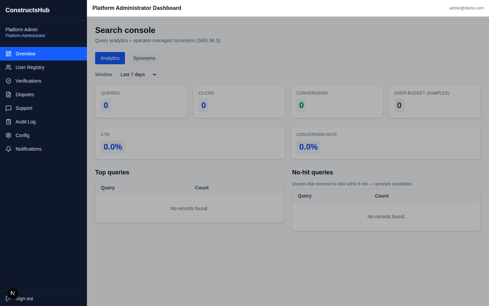
  - 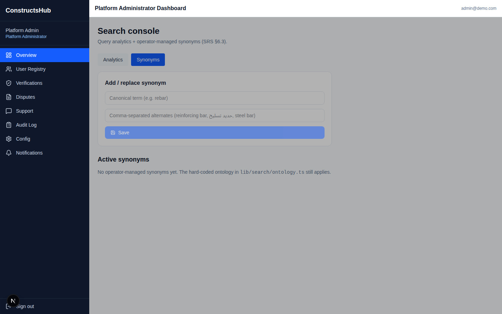
- **What Works:**
  - Tabs (`Analytics`, `Synonyms`, `Engine & Index`), window selector (`24h`, `7d`, `30d`, `90d`), Synonym `Add / replace` + `Delete`, and `Engine & Index` actions (`Trigger Full Reindex`, `Clear Cache`) all call real `/api/admin/search/*` endpoints and function properly.
- **Gaps:**
  - **Missing from Sidebar Navigation** in [`DashboardShell.tsx`](file:///home/meqdad/My-Projects/Construct-Hub_Project/waquor/components/dashboard/DashboardShell.tsx#L103-L112).
  - Empty query analytics and synonym tables in the default seed (`0` `SearchEvent` and `0` `SearchSynonym` rows).

---

### 4.11 `/dashboard/admin/moderation` — Content & Moderation Console (Missing)
- **Screenshot:** 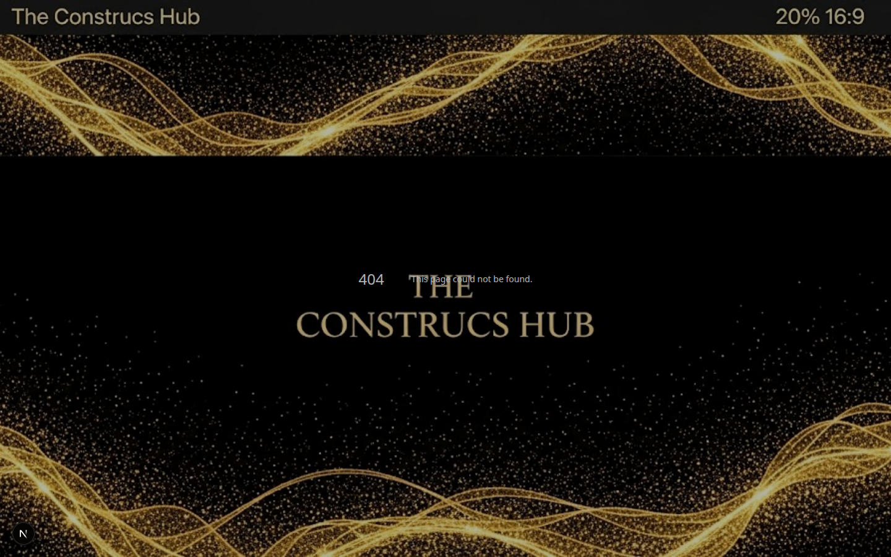
- **Status:** Navigating to `/dashboard/admin/moderation` returns **404 Not Found**. Neither the page nor any moderation/announcement/banner/CMS admin routes exist.

---

## 5. Detailed SRS Master v2.0 (§10.9–10.13) Comparison

### 5.1 §10.9 Super Admin Console & §10.9.1 Configuration Registry (`FR-CFG-01`..`FR-CFG-07`)

| SRS Requirement | Spec Details | Current Implementation | Status |
|---|---|---|---|
| **User, Organization & Role Management (§10.9)** | Create/invite internal staff, assign RBAC roles, suspend/ban/reactivate accounts, manage org hierarchies | Read-only table on `/dashboard/admin/users`; `View →` links 404; no UI for staff invite, role change, suspend/ban, or org management | **Partial (~25%)** |
| **System Health & Telemetry Overview (§10.9)** | Real-time API error rates, queue depths, search index health, BIM sandbox health, notification delivery rates, gateway status | `/dashboard/admin` Health Monitor is an empty dashed placeholder box; `/dashboard/admin/analytics` & `/dashboard/admin/search` exist but are unlinked from sidebar; BIM health (`/api/admin/bim/health`) is not surfaced in any UI | **Partial (~40%)** |
| **Immutable Audit Log Explorer (§10.9 / §15.5)** | Full-text and facet search across `AuditEvent` records by actor, action, target entity, IP, and timestamp range; CSV/JSON export | `/dashboard/admin/audit` queries `prisma.auditLog` (0 rows) instead of `prisma.auditEvent` (21+ rows); no search, filters, or CSV/JSON export | **Broken (~15%)** |
| **FR-CFG-01 Categorized Config UI** | Grouped under Fees & Commissions, Escrow & Payouts, Tenders & Bidding, Workforce & Logistics, Search & AI, Notifications & SLAs, Feature Flags | Only Commission Slabs (3 rows) and broken Feature Flags card exist; Platform Settings are 6 hardcoded text rows | **Partial (~25%)** |
| **FR-CFG-02 Strict Validation & Bounds** | Schema validation per key (e.g., commission `0.00%–50.00%`, SLA hours `1–720`) with descriptive error messages | `POST /api/admin/config` accepts arbitrary numbers without Zod bounds validation | **Missing (0%)** |
| **FR-CFG-03 Effective Dating** | Immediate or scheduled future `effectiveFrom` timestamp; in-flight orders/tenders keep snapshotted rates | `CommissionSlab` has no `effectiveFrom` scheduling UI or order-snapshot locking | **Missing (0%)** |
| **FR-CFG-04 Reason & Dual-Control Approval** | Mandatory change reason (`min 10 chars`); dual-control approval by a second admin if fee/commission changes by `> 20%` or `> 2%` | No change-reason input; no dual-control approval workflow | **Missing (0%)** |
| **FR-CFG-05 Config Version History & One-Click Rollback** | Versioned key changes (`v1, v2, v3...`), diff viewer (`oldValue` vs `newValue`), one-click `Rollback to Version N` | Overwrites `CommissionSlab`/`FeatureFlag` in place; no version history or rollback UI | **Missing (0%)** |
| **FR-CFG-06 Hot-Reload Propagation** | Pub/sub cache invalidation propagating config changes within `<= 60 seconds` without redeploy | No config cache / pub-sub invalidation layer | **Missing (0%)** |
| **FR-CFG-07 Scoped Overrides** | Global default -> Country (`SA` vs `JO`) -> Category -> Organization/Tier resolution | `CommissionSlab` only keys by `vertical` (`Catalogue`, `Projects`, `Logistics`) | **Missing (0%)** |

---

### 5.2 §10.10 Support Workspace

| SRS Requirement | Spec Details | Current Implementation | Status |
|---|---|---|---|
| **Ticket Queue & SLA Triage (§10.10)** | Filterable queue by priority, category, language (`AR`/`EN`), SLA countdown, assigned agent | Static table on `/dashboard/admin/support` with 4 StatCards; `Open →` link 404s; no filters, SLA timers, or agent assignment | **Partial (~25%)** |
| **Unified Customer Timeline (§10.10)** | Single-pane chronological view of user's orders, bids, projects, chats, trips, payouts, notifications, and audit events | Not implemented (`/dashboard/admin/users/[id]` and `/dashboard/admin/support/[id]` both 404) | **Missing (0%)** |
| **Read-Only Impersonation ("View as User") (§10.10)** | Render UI as target user in read-only mode with persistent watermark banner and mandatory `AuditEvent` entry | Not implemented | **Missing (0%)** |
| **Safe Intervention Actions (§10.10)** | Resend verification OTP/email, regenerate ZATCA invoice PDF, re-trigger failed webhook, extend escrow inspection timer, escalate to Dispute/Finance | Not implemented | **Missing (0%)** |
| **Canned Responses & Internal Notes (§10.10)** | Bilingual (`AR`/`EN`) response templates and private internal agent notes | Not implemented | **Missing (0%)** |

---

### 5.3 §10.11 Verification Console

| SRS Requirement | Spec Details | Current Implementation | Status |
|---|---|---|---|
| **Verification Queue (§10.11)** | Queue of `VerificationCase` records filterable by role, country (`SA`/`JO`), document type, submission age | Queries `User.where({ isVerified: false })` instead of `VerificationCase`; crashes with RSC `onClick` error when rows exist | **Broken (~20%)** |
| **Side-by-Side Document Viewer (§10.11)** | Split-screen viewer showing uploaded PDFs/images beside extracted metadata (`CR Number`, `VAT/TRN`, `IBAN`, `National ID`, `Expiry Date`) | Only renders an external `<a href={authDocumentUrl}>View Doc</a>` link | **Missing (0%)** |
| **External Registry Cross-Check (§10.11)** | Status indicators and one-click re-query for Saudi Ministry of Commerce CR, ZATCA VAT, GOSI, Balady, Jordan CCD | Not implemented | **Missing (0%)** |
| **Decision Workflow (§10.11)** | `Approve` (sets `verifiedAt`, sets `expiresAt` for 30/14/7-day renewal alerts, grants badge), `Reject` (reason code), `Request More Info` | `Approve` and `Reject` buttons have `onClick={() => {}}` and crash RSC rendering; [`PATCH /api/verifications/[caseId]`](file:///home/meqdad/My-Projects/Construct-Hub_Project/waquor/src/app/api/verifications/%5BcaseId%5D/route.ts) exists on backend but is unwired | **Broken (API only)** |
| **Sanctions & PEP Screening Review (§10.11)** | Resolve fuzzy-match hits flagged by `lib/sanctions.ts` | `lib/sanctions.ts` exists on backend, but no admin UI surfaces screening hits | **Missing (0%)** |

---

### 5.4 §10.12 Finance Console & §8.7 Automated Reconciliation (`FR-FIN-01`)

| SRS Requirement | Spec Details | Current Implementation | Status |
|---|---|---|---|
| **Escrow & Ledger Explorer (§10.12)** | Searchable double-entry `LedgerEntry` journal and `EscrowHold` inspector | Aggregate totals shown on Reconciliation tab; no searchable `LedgerEntry` or `EscrowHold` table inspector | **Partial (~40%)** |
| **Payout Approval Queue (§10.12)** | Review pending `Payout` requests, verify IBAN match, approve/reject with reason, trigger batch bank transfer | UI built on `/dashboard/admin/finance`, **but crashes when any `Payout` row exists** because `r.recipient` is an object; `GET /api/payouts` also leaks `passwordHash` | **Broken (Crashes)** |
| **Daily Gateway & Bank Reconciliation (§10.12)** | Automated matching of gateway settlement files (`Stripe`, `Moyasar`, `HyperPay`) against internal `LedgerEntry` rows | Compares internal `LedgerEntry` vs `EscrowHold` + `Wallet` totals, but does not ingest external gateway settlement files | **Partial (~50%)** |
| **ZATCA / Jofotara Tax Compliance Monitor (§10.12)** | Real-time monitor of e-invoice clearance/reporting statuses, XML validation errors, PIH chain integrity, and one-click retry | ZATCA APIs exist (`/api/zatca/*`), but Finance Console has no ZATCA monitor tab | **Missing (0%)** |
| **Refund, Chargeback & Dispute Ruling Execution (§10.12)** | Execute financial splits from dispute rulings and log gateway chargebacks | Chargeback Log tab exists, **but crashes on `refundedEscrows`** due to missing `status` and mismatched field names (`party`/`reason`/`createdAt`) | **Broken (Crashes)** |
| **Month-End Close & Financial Exports (§10.12 / §8.7 `FR-FIN-01`)** | Export trial balance, VAT return summary (`SA 15%` / `JO 16%`), commission revenue report (CSV/XLSX), and execute **Period Lock** rejecting backdated `LedgerEntry` writes (`409 PERIOD_LOCKED`) | No CSV/XLSX export buttons and no Period Lock model/endpoint | **Missing (0%)** |

---

### 5.5 §10.13 Content & Moderation Console

| SRS Requirement | Spec Details | Current Implementation | Status |
|---|---|---|---|
| **Flagged Content Queue (§10.13)** | Review user-reported listings, tenders, job posts, chat messages, and reviews; remove content, warn user, or suspend account | `/dashboard/admin/moderation` returns **404 Not Found**; no flagged-content queue exists | **Missing (0%)** |
| **Category, Taxonomy & Attribute Manager (§10.13)** | Manage product categories, service trades, equipment types, units of measure (`UoM`), and bSDD mappings (`AR`/`EN`) | Not implemented in admin UI | **Missing (0%)** |
| **Banner, Announcement & CMS Manager (§10.13)** | Schedule promotional banners, system maintenance alerts (`Announcement` model exists in Prisma), and update static policy pages | `Announcement` model exists in `schema.prisma`, but no admin CRUD UI or API exists | **Missing (0%)** |
| **Search Synonym & Boost Manager (§10.13 / §6.3)** | Curate Arabic/English construction synonyms and zero-result queries | Implemented at [`/dashboard/admin/search`](file:///home/meqdad/My-Projects/Construct-Hub_Project/waquor/src/app/dashboard/admin/search/page.tsx), but missing from sidebar navigation | **Functional (Unlinked)** |

---

## 6. Prioritized Remediation Punch List

1. **P0 — Fix Runtime Crashes & PII Leak Immediately:**
   - **Sanitize `GET /api/payouts` ([`waquor/src/app/api/payouts/route.ts`](file:///home/meqdad/My-Projects/Construct-Hub_Project/waquor/src/app/api/payouts/route.ts#L64-L69)):** Replace `include: { recipient: { include: { profile: true } } }` with `select: { id: true, email: true, userType: true, profile: { select: { fullName: true, companyName: true } } }` so `passwordHash` is never serialized, and normalize `recipient` in [`finance/page.tsx`](file:///home/meqdad/My-Projects/Construct-Hub_Project/waquor/src/app/dashboard/admin/finance/page.tsx#L217-L271) to a display string (`r.recipient?.profile?.fullName || r.recipient?.email`).
   - **Fix Chargeback API/UI Contract ([`waquor/src/app/api/admin/finance/chargebacks/route.ts`](file:///home/meqdad/My-Projects/Construct-Hub_Project/waquor/src/app/api/admin/finance/chargebacks/route.ts)):** Normalize every item in `chargebacks` to `{ id, type, amount, status, party, reason, createdAt }` and apply `dateFrom`/`dateTo` filtering.
   - **Fix Verifications RSC Crash & Wire Buttons ([`waquor/src/app/dashboard/admin/verifications/page.tsx`](file:///home/meqdad/My-Projects/Construct-Hub_Project/waquor/src/app/dashboard/admin/verifications/page.tsx)):** Extract interactive `Approve`/`Reject` actions into a Client Component wired to `PATCH /api/verifications/[caseId]` and `POST /api/admin/dashboard`.
2. **P1 — Fix Layout, Navigation, Audit Table & Empty Config Bugs:**
   - **Remove Duplicate `<DashboardShell>` and hardcoded `dir="rtl"`** in [`waquor/src/app/dashboard/admin/finance/page.tsx`](file:///home/meqdad/My-Projects/Construct-Hub_Project/waquor/src/app/dashboard/admin/finance/page.tsx#L425-L434).
   - **Add Missing Sidebar Links (`Finance`, `Analytics`, `Search Console`)** to `NAV_BY_ROLE.USR_ADMIN` in [`waquor/components/dashboard/DashboardShell.tsx`](file:///home/meqdad/My-Projects/Construct-Hub_Project/waquor/components/dashboard/DashboardShell.tsx#L103-L112) and fix exact-match active highlighting for `/dashboard/admin`.
   - **Unify Audit Logging:** Point [`/dashboard/admin/audit/page.tsx`](file:///home/meqdad/My-Projects/Construct-Hub_Project/waquor/src/app/dashboard/admin/audit/page.tsx), [`/dashboard/admin/page.tsx`](file:///home/meqdad/My-Projects/Construct-Hub_Project/waquor/src/app/dashboard/admin/page.tsx), and [`GET /api/admin/audit`](file:///home/meqdad/My-Projects/Construct-Hub_Project/waquor/src/app/api/admin/audit/route.ts) at `prisma.auditEvent` (or dual-write/merge `AuditEvent` + `AuditLog`).
   - **Fix Empty Feature Flags Fallback:** In [`/dashboard/admin/config/page.tsx`](file:///home/meqdad/My-Projects/Construct-Hub_Project/waquor/src/app/dashboard/admin/config/page.tsx#L31-L45), seed default flags when `d.flags.length === 0` (not only inside `.catch()`).
   - **Build Detail Routes or Inline Modals for 404 Links:** Create `/dashboard/admin/users/[id]`, `/dashboard/admin/disputes/[id]` (wired to `PATCH /api/disputes/[disputeId]`), and `/dashboard/admin/support/[id]`.
3. **P2 — Complete Remaining SRS §10.9–10.13 Scope:**
   - Build `/dashboard/admin/moderation` (SRS §10.13: flagged content queue, taxonomy manager, announcement/banner manager).
   - Expand `/dashboard/admin/config` to meet `FR-CFG-01..07` (bounds validation, effective dating, change reason + dual-control approval, version history + rollback, hot-reload cache, scoped overrides).
   - Add Month-End Close Period Lock & CSV/XLSX financial exports (`FR-FIN-01`) and ZATCA compliance monitor to `/dashboard/admin/finance`.
