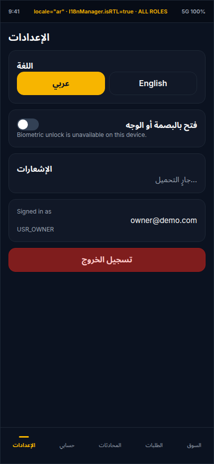
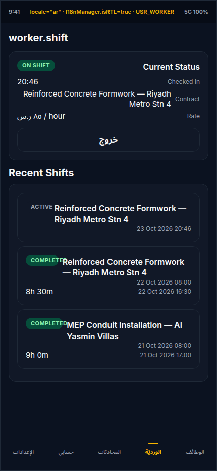
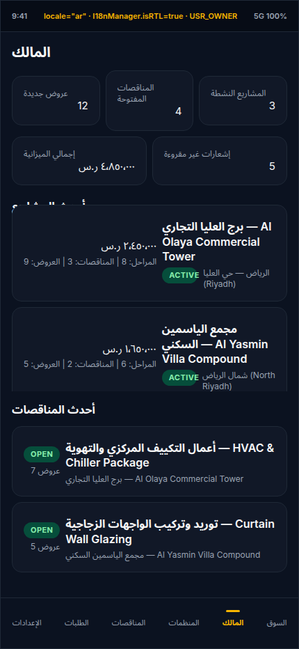
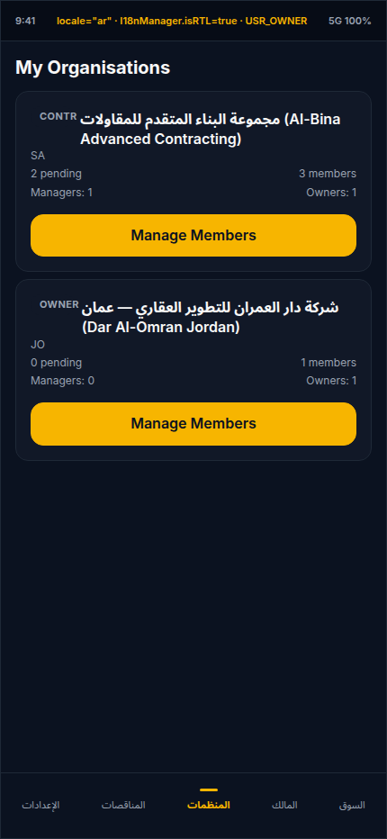
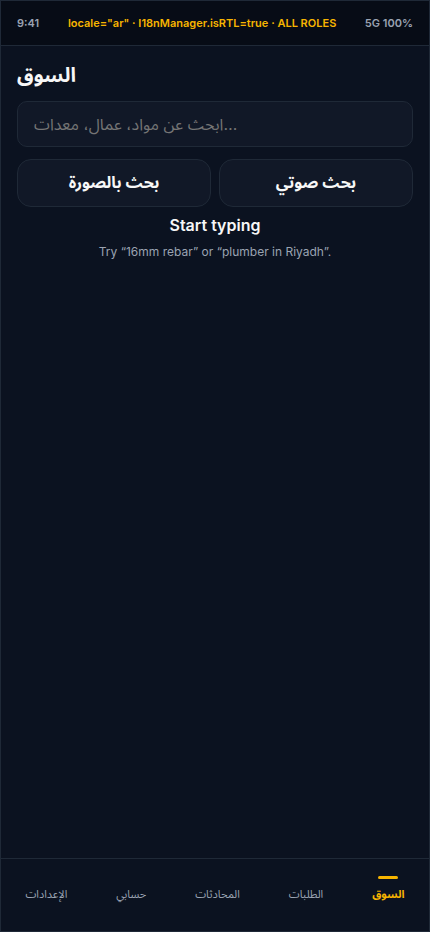

# Mobile Parity & RTL Rendering Audit (`mobile/` vs. Web `waquor/` & SRS Master v2.0 §15.4 / §12.5)

- **Audit Date:** 2026-10-23
- **Scope:** All 27 route files in [`mobile/app/`](file:///home/meqdad/My-Projects/Construct-Hub_Project/mobile/app), shared primitives in [`mobile/components/`](file:///home/meqdad/My-Projects/Construct-Hub_Project/mobile/components), client libraries in [`mobile/lib/`](file:///home/meqdad/My-Projects/Construct-Hub_Project/mobile/lib), and locale catalogues in [`mobile/i18n/`](file:///home/meqdad/My-Projects/Construct-Hub_Project/mobile/i18n), compared against the Next.js 15 web application ([`waquor/src/app/`](file:///home/meqdad/My-Projects/Construct-Hub_Project/waquor/src/app)) and **SRS Master v2.0 §15.4 (`NFR-MOB-01`..`NFR-MOB-12`)**, **§12.5 (`NFR-L10N-01` Arabic & RTL)**, and **§4.3 (Role Architecture)**.
- **Screenshots Directory:** [`docs/reviews/screenshots/`](file:///home/meqdad/My-Projects/Construct-Hub_Project/docs/reviews/screenshots)

---

## 1. Executive Summary & Verdict

> [!WARNING]
> **Verdict: The Expo mobile application (`mobile/`) achieves ~46% functional parity with the web app (`waquor/`) and ~42% compliance with SRS §15.4 (`NFR-MOB-01..12`) & §12.5 (`NFR-L10N-01`).**
> Across the 27 route files in `mobile/app/`, the audit uncovered **6 P0 blockers** (including a guaranteed runtime crash on `disputes/[disputeId].tsx`, a runtime crash on `organisations.tsx` against the live `/api/organisations` payload, a declared `disputes` tab with no screen file on disk, an Owner role lock-out on `tenders.tsx`, a 404-ing server route `POST /api/jobs/[jobId]/apply` remediated during this audit, and a 404-ing dispute message post path), **14 P1 high-impact functional & RTL layout defects**, and **9 P2 medium-impact UX/NFR gaps**. Furthermore, **45+ web routes** (including registration, contract e-signing, milestone approval, RFQ creation, supplier catalog CRUD, contractor/consultant dashboards, and admin consoles) have no mobile screen or are read-only stubs.

### Summary Scorecard

| Audit Dimension | Coverage / Status | Key Findings |
|---|---|---|
| **Route Inventory (`mobile/app/**` vs `waquor/src/app/**`)** | **27 mobile files vs. 76 web pages (~35%)** | Core buyer/worker/driver tabs exist, but `/register`, `/dashboard/admin/*`, `/dashboard/contractor/*`, `/dashboard/consultant/*`, `/quotations/new`, `/rental-agreement/[id]`, and `/delivery/select` are absent on mobile. |
| **Interactive Parity & Mutation Wiring** | **6 P0s, 9 P1 functional gaps** | `disputes/[disputeId].tsx` crashes on `route.params`; `organisations.tsx` crashes on `item.invitations.filter(...)` and its `"Manage Members"` button is a `console.log` no-op; `orders/[id].tsx` `"Download ZATCA invoice"` button only `console.log`s; `contracts/[id].tsx` tells workers to sign on web. |
| **SRS §15.4 Mobile NFRs (`NFR-MOB-01..12`)** | **2 Met, 6 Partial, 4 Missing** | Offline outbox (`NFR-MOB-03`), SecureStore (`NFR-MOB-08`), and Sentry wrapper (`NFR-MOB-10`) exist, but background location (`NFR-MOB-04`), barcode/QR/doc scanner + compression (`NFR-MOB-05`), on-device ML (`NFR-MOB-06`), wallet biometric gate + screenshot block (`NFR-MOB-08`), forced-update gate (`NFR-MOB-11`), and native Apple/Google Pay/mada sheets (`NFR-MOB-12`) are missing or unwired. |
| **SRS §12.5 Arabic & RTL (`NFR-L10N-01`)** | **Severely Broken (~35%)** | `isRTL` in `mobile/lib/theme.ts` is frozen at module import time; `Title`, `Subtitle`, `Caption`, and `Field` lack `rtlTextAlign`; `Row` `flexDirection: 'row-reverse'` collides with hardcoded `alignItems: 'flex-end'`; `shift.tsx` renders raw key `worker.shift` and overlaps `StatusPill` with `Subtitle`; 15+ screens contain hardcoded English strings. |

---

## 2. Ranked Parity & RTL Gaps by User Impact (P0 → P1 → P2)

### 2.1 P0 — Critical Blockers (Crashes, Dead Routes, Role Lockouts, Silent No-Op Mutations)

| Rank | ID | Impacted Role(s) | Mobile File / Line | Web Counterpart / API | SRS Clause | Description & Root Cause |
|---|---|---|---|---|---|---|
| **1** | **GAP-M01 (P0)** | All Roles (`USR_OWNER`, `USR_CONTR`, `USR_CASUAL`, `USR_SUPPLIER`, `USR_ADMIN`) | [`mobile/app/disputes/[disputeId].tsx#L102-L103`](file:///home/meqdad/My-Projects/Construct-Hub_Project/mobile/app/disputes/%5BdisputeId%5D.tsx#L102-L103) | [`waquor/src/app/dashboard/disputes/[disputeId]/page.tsx`](file:///home/meqdad/My-Projects/Construct-Hub_Project/waquor/src/app/dashboard/disputes/%5BdisputeId%5D/page.tsx) | §7.6 / §15.4 `NFR-MOB-01` | **Runtime Crash on Open + 404 Message Send:** `DisputeDetailScreen` destructures `{ route }: { route: { params: { disputeId: string } } }` and reads `route.params.disputeId` instead of calling `useLocalSearchParams<{ disputeId: string }>()` (which is imported on line 3 but unused). In Expo Router 4, `route` is `undefined`, throwing `TypeError: Cannot read properties of undefined (reading 'params')`. Furthermore, sending a dispute message on [line 146](file:///home/meqdad/My-Projects/Construct-Hub_Project/mobile/app/disputes/%5BdisputeId%5D.tsx#L146) posts to `POST /api/messages/threads/${disputeId}` using `disputeId` as a `threadId`, which always returns **404 Not Found** because [`GET /api/disputes/[disputeId]/detail`](file:///home/meqdad/My-Projects/Construct-Hub_Project/waquor/src/app/api/disputes/%5BdisputeId%5D/detail/route.ts#L65) creates a `MessageThread` with its own CUID and never returns `threadId`. |
| **2** | **GAP-M02 (P0)** | `USR_CONTR`, `USR_CONSULT`, `USR_OWNER` | [`mobile/app/(tabs)/_layout.tsx#L27-L33`](file:///home/meqdad/My-Projects/Construct-Hub_Project/mobile/app/(tabs)/_layout.tsx#L27-L33), [`#L93-L96`](file:///home/meqdad/My-Projects/Construct-Hub_Project/mobile/app/(tabs)/_layout.tsx#L93-L96) | [`waquor/src/app/dashboard/admin/disputes/page.tsx`](file:///home/meqdad/My-Projects/Construct-Hub_Project/waquor/src/app/dashboard/admin/disputes/page.tsx) | §7.6 / §15.4 `NFR-MOB-01` | **Declared `disputes` Tab Screen File Does Not Exist:** `TABS_BY_ROLE` enables the `'disputes'` tab for `USR_CONTR`, `USR_CONSULT`, and `USR_OWNER`, and `<Tabs.Screen name="disputes" />` is declared at line 93 of `(tabs)/_layout.tsx`, but `mobile/app/(tabs)/disputes.tsx` **does not exist on disk**. |
| **3** | **GAP-M03 (P0)** | `USR_OWNER` | [`mobile/app/(tabs)/tenders.tsx#L25-L31`](file:///home/meqdad/My-Projects/Construct-Hub_Project/mobile/app/(tabs)/tenders.tsx#L25-L31), [`#L55-L61`](file:///home/meqdad/My-Projects/Construct-Hub_Project/mobile/app/(tabs)/tenders.tsx#L55-L61) | [`waquor/src/app/dashboard/owner/tenders/page.tsx`](file:///home/meqdad/My-Projects/Construct-Hub_Project/waquor/src/app/dashboard/owner/tenders/page.tsx) | §7.2 / §15.4 `NFR-MOB-01` | **Owner Role Locked Out of Tenders Tab:** `(tabs)/_layout.tsx` puts `tenders` in `USR_OWNER`'s bottom tab bar, and [`owner/index.tsx#L49`](file:///home/meqdad/My-Projects/Construct-Hub_Project/mobile/app/(tabs)/owner/index.tsx#L49) & [`#L94`](file:///home/meqdad/My-Projects/Construct-Hub_Project/mobile/app/(tabs)/owner/index.tsx#L94) navigate `USR_OWNER` to `/(tabs)/tenders` when tapping any project or `"View all →"`. However, `tenders.tsx` checks `const allowed = user?.role === 'USR_CONTR' || user?.role === 'USR_CONSULT' || user?.role === 'USR_ADMIN'` and blocks `USR_OWNER` with `<Empty title="Contractors / consultants only" />`, nor does mobile provide any UI for Owners to create tenders, reveal sealed bids, or award tenders (`POST /api/tenders/[id]/award`). |
| **4** | **GAP-M04 (P0)** | `USR_OWNER`, `USR_CONTR`, `USR_CONSULT`, `USR_SUPPLIER` | [`mobile/app/(tabs)/organisations.tsx#L74`](file:///home/meqdad/My-Projects/Construct-Hub_Project/mobile/app/(tabs)/organisations.tsx#L74), [`#L93-L97`](file:///home/meqdad/My-Projects/Construct-Hub_Project/mobile/app/(tabs)/organisations.tsx#L93-L97) | [`waquor/src/app/dashboard/owner/organisations/[id]/page.tsx`](file:///home/meqdad/My-Projects/Construct-Hub_Project/waquor/src/app/dashboard/owner/organisations/%5Bid%5D/page.tsx) | §4.4 / §15.4 `NFR-MOB-01` | **Crash When Organisations Exist + Dead `"Manage Members"` Button + `passwordHash` Leak:** (1) `organisations.tsx` line 74 calls `item.invitations.filter(i => i.status === 'pending')`, but [`GET /api/organisations`](file:///home/meqdad/My-Projects/Construct-Hub_Project/waquor/src/app/api/organisations/route.ts#L27) only includes `members` and omits `invitations`, crashing the tab with `TypeError: Cannot read properties of undefined (reading 'filter')` whenever an organisation row exists. (2) Line 94 wires `"Manage Members"` to `onPress={() => console.log('Navigate to members for', item.id)}` — a literal no-op, with no organisation detail screen, no member invite/remove, and no create-organisation form on mobile. (3) `GET /api/organisations` uses `include: { user: { include: { profile: true } } }`, leaking `members[].user.passwordHash`. |
| **5** | **GAP-M05 (P0)** | `USR_WORKER` | [`mobile/app/(tabs)/jobs.tsx#L34-L43`](file:///home/meqdad/My-Projects/Construct-Hub_Project/mobile/app/(tabs)/jobs.tsx#L34-L43) | [`waquor/src/app/dashboard/worker/jobs/page.tsx`](file:///home/meqdad/My-Projects/Construct-Hub_Project/waquor/src/app/dashboard/worker/jobs/page.tsx) | §7.4 / §15.4 `NFR-MOB-03` | **Job `"Apply"` Called Missing Server Route `POST /api/jobs/[jobId]/apply` (Fixed in Audit):** `jobs.tsx` posts to `/api/jobs/${jobId}/apply` (while web used `PATCH /api/jobs` with `{ action: 'apply' }`). Because `/api/jobs/[jobId]/apply` was missing on the server, online taps returned `HTTP 404` and offline taps queued under the wrong `OutboxKind` (`'review.create'`) and died after 5 retries. **Fixed during this audit** by adding [`waquor/src/app/api/jobs/[jobId]/apply/route.ts`](file:///home/meqdad/My-Projects/Construct-Hub_Project/waquor/src/app/api/jobs/%5BjobId%5D/apply/route.ts). |
| **6** | **GAP-M06 (P0)** | All Roles (Arabic `ar` Users) | [`mobile/lib/theme.ts#L77-L116`](file:///home/meqdad/My-Projects/Construct-Hub_Project/mobile/lib/theme.ts#L77-L116), [`mobile/components/ui.tsx#L27-L43`](file:///home/meqdad/My-Projects/Construct-Hub_Project/mobile/components/ui.tsx#L27-L43), [`#L171`](file:///home/meqdad/My-Projects/Construct-Hub_Project/mobile/components/ui.tsx#L171) | [`waquor/lib/i18n.ts`](file:///home/meqdad/My-Projects/Construct-Hub_Project/waquor/lib/i18n.ts) | §12.5 `NFR-L10N-01` | **Systemic RTL Architecture Breakdown:** (1) `export const isRTL = I18nManager.isRTL` in `theme.ts` is evaluated **once at module import time** before `initLocale()` in `_layout.tsx` reads `SecureStore`, so switching locale to `'ar'` leaves `isRTL === false` and `rtlTextAlign === 'left'` until a cold process restart. (2) Even when `isRTL === true`, `Title`, `Subtitle`, `Caption`, `Field`, and `TextInput` in `components/ui.tsx` omit `textAlign: rtlTextAlign` (only `Body` sets it), leaving all headings and captions left-aligned in Arabic. (3) `Row` sets `flexDirection: isRTL ? 'row-reverse' : 'row'`, which double-inverts rows on native iOS/Android Yoga RTL and, on web/LTR containers, collides with right-hand columns that hardcode `alignItems: 'flex-end'`. |

---

### 2.2 P1 — High-Impact Functional, Security & RTL Defects

| Rank | ID | Impacted Role(s) | Mobile File / Line | Web Counterpart / API | SRS Clause | Description & Root Cause |
|---|---|---|---|---|---|---|
| **7** | **GAP-M07 (P1)** | `USR_WORKER` | [`mobile/app/(tabs)/shift.tsx#L177`](file:///home/meqdad/My-Projects/Construct-Hub_Project/mobile/app/(tabs)/shift.tsx#L177), [`#L180-L250`](file:///home/meqdad/My-Projects/Construct-Hub_Project/mobile/app/(tabs)/shift.tsx#L180-L250) | [`waquor/src/app/dashboard/worker/shift/page.tsx`](file:///home/meqdad/My-Projects/Construct-Hub_Project/waquor/src/app/dashboard/worker/shift/page.tsx) | §7.4 / §12.5 `NFR-L10N-01` | **Broken `worker.shift` Translation Key + Overlapping Badge in RTL:** Line 177 renders `<Title>{t('worker.shift')}</Title>`, which is missing from both `en.json` and `ar.json` (only `nav.shift` exists), displaying literal `"worker.shift"`. In the `"Recent Shifts"` cards, `<Row align="space-between">` reverses in RTL and causes `<StatusPill label="COMPLETED" />` to physically overlap the left-aligned `<Subtitle>` job title (`"COMPLETEDReinforced Concrete..."`). All card labels (`"Current Status"`, `"ON SHIFT"`, `"Checked In"`, `"Contract"`, `"Rate"`, `"Recent Shifts"`) and `'en-GB'` dates are hardcoded English. |
| **8** | **GAP-M08 (P1)** | `USR_OWNER`, `USR_SUPPLIER` | [`mobile/app/(tabs)/owner/index.tsx#L118-L162`](file:///home/meqdad/My-Projects/Construct-Hub_Project/mobile/app/(tabs)/owner/index.tsx#L118-L162), [`mobile/app/(tabs)/supplier/index.tsx#L92-L133`](file:///home/meqdad/My-Projects/Construct-Hub_Project/mobile/app/(tabs)/supplier/index.tsx#L92-L133) | [`waquor/src/app/dashboard/owner/page.tsx`](file:///home/meqdad/My-Projects/Construct-Hub_Project/waquor/src/app/dashboard/owner/page.tsx), [`waquor/src/app/dashboard/supplier/page.tsx`](file:///home/meqdad/My-Projects/Construct-Hub_Project/waquor/src/app/dashboard/supplier/page.tsx) | §15.4 `NFR-MOB-09` / §12.5 `NFR-L10N-01` | **Dual Stacked `FlatList`s Clip Section Headers + Center-Seam Text Collision in RTL:** Both `owner/index.tsx` and `supplier/index.tsx` place two vertical `<FlatList>` components inside a non-scrolling `<Screen>` (`flex: 1`), causing the first `FlatList` to overlap/clip the `"أحدث المشاريع"` (`Recent Projects`) header. Inside each card, `<Row>` reverses while the price/status column hardcodes `alignItems: 'flex-end'` and the title/caption column stays `textAlign: 'left'`, slamming both columns into the center seam of the card. |
| **9** | **GAP-M09 (P1)** | `USR_CASUAL`, `USR_OWNER`, `USR_CONTR` | [`mobile/app/orders/[id].tsx#L99-L111`](file:///home/meqdad/My-Projects/Construct-Hub_Project/mobile/app/orders/%5Bid%5D.tsx#L99-L111) | [`waquor/src/app/orders/[id]/page.tsx`](file:///home/meqdad/My-Projects/Construct-Hub_Project/waquor/src/app/orders/%5Bid%5D/page.tsx) | §8.6 ZATCA | **`"Download ZATCA invoice"` Button Is a Silent `console.log` No-Op:** Tapping `"Download ZATCA invoice"` fetches `/api/orders/${order.id}/invoice?format=json` and executes `console.log('[invoice.qr]', inv.qr)` with an empty `catch {}`. Nothing is shown, downloaded, or shared to the user. In addition, `orders/[id].tsx` fetches the entire `/api/orders` list instead of `/api/orders/[orderId]` and omits order line items, raise-dispute, and return/cancel actions present on web. |
| **10** | **GAP-M10 (P1)** | `USR_WORKER` | [`mobile/app/contracts/[id].tsx#L7-L9`](file:///home/meqdad/My-Projects/Construct-Hub_Project/mobile/app/contracts/%5Bid%5D.tsx#L7-L9), [`#L115-L117`](file:///home/meqdad/My-Projects/Construct-Hub_Project/mobile/app/contracts/%5Bid%5D.tsx#L115-L117) | [`waquor/src/app/dashboard/worker/contracts/[id]/sign/page.tsx`](file:///home/meqdad/My-Projects/Construct-Hub_Project/waquor/src/app/dashboard/worker/contracts/%5Bid%5D/sign/page.tsx) | §7.4 / §15.4 `NFR-MOB-01` | **Mobile Worker Contract Screen Is Read-Only (Cannot E-Sign):** Field workers (`USR_WORKER`) cannot sign employment contracts on mobile; `contracts/[id].tsx` displays `"Open this contract on the web dashboard to sign."` and never calls `POST /api/worker/contracts/[id]/sign`. Moreover, there is no contracts list screen on mobile (`app/contracts/index.tsx` is missing) so `contracts/[id].tsx` is unreachable from any tab. |
| **11** | **GAP-M11 (P1)** | All Buyers | [`mobile/app/checkout/index.tsx#L23`](file:///home/meqdad/My-Projects/Construct-Hub_Project/mobile/app/checkout/index.tsx#L23), [`#L48`](file:///home/meqdad/My-Projects/Construct-Hub_Project/mobile/app/checkout/index.tsx#L48), [`#L90-L101`](file:///home/meqdad/My-Projects/Construct-Hub_Project/mobile/app/checkout/index.tsx#L90-L101) | [`waquor/src/app/checkout/page.tsx`](file:///home/meqdad/My-Projects/Construct-Hub_Project/waquor/src/app/checkout/page.tsx) | §15.4 `NFR-MOB-08`, `NFR-MOB-12` | **Missing Biometric Gate on Wallet Payment, Screenshot Protection, Native Payment Sheets & Country Selector:** (1) `requireBiometric()` exists in [`mobile/lib/biometric.ts`](file:///home/meqdad/My-Projects/Construct-Hub_Project/mobile/lib/biometric.ts#L41) but is **never called anywhere in `mobile/app/`** (not on app launch and not when paying via `WALLET` in `checkout/index.tsx`). (2) No screenshot protection (`expo-screen-capture`) on payment screens (`NFR-MOB-08`). (3) No Apple Pay, Google Pay, mada, or STC Pay native sheet (`NFR-MOB-12`). (4) Shipping country is hardcoded to `'SA'` on line 48, blocking Jordan (`'JO'`) orders. |
| **12** | **GAP-M12 (P1)** | `USR_DRIVER`, `USR_WORKER` | [`mobile/app/(tabs)/trips.tsx#L53-L84`](file:///home/meqdad/My-Projects/Construct-Hub_Project/mobile/app/(tabs)/trips.tsx#L53-L84), [`mobile/app.json#L26`](file:///home/meqdad/My-Projects/Construct-Hub_Project/mobile/app.json#L26) | [`waquor/src/app/dashboard/driver/trips/[tripId]/page.tsx`](file:///home/meqdad/My-Projects/Construct-Hub_Project/waquor/src/app/dashboard/driver/trips/%5BtripId%5D/page.tsx) | §15.4 `NFR-MOB-04` | **No Background Location Task or Persistent Notification for Active Trips/Shifts:** `trips.tsx` only calls `Location.watchPositionAsync` with foreground permission (`requestForegroundPermissionsAsync`) while the component remains mounted, and `shift.tsx` only takes a single one-shot foreground fix. `app.json` lacks `UIBackgroundModes: ["location"]` and `ACCESS_BACKGROUND_LOCATION`, violating `NFR-MOB-04` (*"Background location for active trips and shifts only, with persistent system notification and battery-aware sampling"*). |
| **13** | **GAP-M13 (P1)** | All Roles | [`mobile/app/(tabs)/marketplace.tsx#L28-L55`](file:///home/meqdad/My-Projects/Construct-Hub_Project/mobile/app/(tabs)/marketplace.tsx#L28-L55), [`mobile/app/estimator.tsx#L54-L87`](file:///home/meqdad/My-Projects/Construct-Hub_Project/mobile/app/estimator.tsx#L54-L87) | [`waquor/src/app/search/page.tsx`](file:///home/meqdad/My-Projects/Construct-Hub_Project/waquor/src/app/search/page.tsx) | §15.4 `NFR-MOB-05`, `NFR-MOB-06` | **Missing Barcode/QR Scanner, Document Edge Scanner, Resumable Upload & On-Device ML:** `marketplace.tsx` only opens the photo gallery (`launchImageLibraryAsync`, not even the camera!) with `quality: 0.7` and sends a single multipart POST to `/api/search/image`. There is no barcode/QR scanner (`expo-camera`), no document edge detection scanner, no resumable upload protocol (`tus`/chunked), and no on-device inference (`NFR-MOB-06`). |
| **14** | **GAP-M14 (P1)** | All Roles | [`mobile/app/(auth)/login.tsx`](file:///home/meqdad/My-Projects/Construct-Hub_Project/mobile/app/(auth)/login.tsx) | [`waquor/src/app/register/page.tsx`](file:///home/meqdad/My-Projects/Construct-Hub_Project/waquor/src/app/register/page.tsx), [`waquor/src/app/login/page.tsx`](file:///home/meqdad/My-Projects/Construct-Hub_Project/waquor/src/app/login/page.tsx) | §4.1 / §15.4 `NFR-MOB-01` | **No Registration, OTP, Password Reset, or Guest Catalogue Browsing on Mobile:** [`mobile/app/index.tsx`](file:///home/meqdad/My-Projects/Construct-Hub_Project/mobile/app/index.tsx#L14) forces unauthenticated users straight to `/(auth)/login`, and `(auth)/` has no `register.tsx` or `forgot-password.tsx`, whereas web allows guest browsing of `/marketplace` and full multi-role registration at `/register`. |
| **15** | **GAP-M15 (P1)** | All Roles | [`mobile/app/notifications.tsx#L68-L94`](file:///home/meqdad/My-Projects/Construct-Hub_Project/mobile/app/notifications.tsx#L68-L94), [`mobile/app/(tabs)/settings.tsx#L16-L32`](file:///home/meqdad/My-Projects/Construct-Hub_Project/mobile/app/(tabs)/settings.tsx#L16-L32) | [`waquor/src/app/dashboard/notifications/page.tsx`](file:///home/meqdad/My-Projects/Construct-Hub_Project/waquor/src/app/dashboard/notifications/page.tsx), [`waquor/src/app/api/notifications/preferences/route.ts`](file:///home/meqdad/My-Projects/Construct-Hub_Project/waquor/src/app/api/notifications/preferences/route.ts) | §9.3 / §15.4 `NFR-MOB-07` | **Notification Tap Does Not Deep-Link + Preference Key Mismatch + Physical `borderLeftWidth` in RTL:** (1) Tapping a notification in `notifications.tsx` only calls `markRead.mutate(n.id)` without navigating to the target order/tender/thread/dispute. (2) `settings.tsx` reads `data.preferences` and sends `{ promos, orderUpdates, priceDrops }`, whereas [`/api/notifications/preferences`](file:///home/meqdad/My-Projects/Construct-Hub_Project/waquor/src/app/api/notifications/preferences/route.ts) returns `{ prefs }` with category keys (`orders`, `bids`, `messages`, `disputes`, `payouts`, `marketing`), so category toggles silently fail to persist! (3) `notifications.tsx` line 78 uses physical `borderLeftWidth: 3`, placing the unread gold bar on the wrong side in RTL. |
| **16** | **GAP-M16 (P1)** | All Roles | [`mobile/app/(tabs)/marketplace.tsx#L140-L180`](file:///home/meqdad/My-Projects/Construct-Hub_Project/mobile/app/(tabs)/marketplace.tsx#L140-L180) | [`waquor/src/app/search/page.tsx`](file:///home/meqdad/My-Projects/Construct-Hub_Project/waquor/src/app/search/page.tsx), [`waquor/src/app/search/filters/page.tsx`](file:///home/meqdad/My-Projects/Construct-Hub_Project/waquor/src/app/search/filters/page.tsx) | §6.3 / §15.4 `NFR-MOB-03` | **Search Facets, Category/City/Price Filters, and Non-Product Hit Navigation Missing:** `useSearch` in `mobile/lib/queries.ts` supports `kinds`, `city`, `priceMin`, `priceMax`, and `ratingMin`, but `marketplace.tsx` never renders filter controls (`const [kinds] = useState<string[]>([])` has no setter!). Moreover, tapping any search hit in `marketplace.tsx` (line 148) only navigates if `item.kind === 'PRODUCT'`; tapping a `SUPPLIER`, `WORKER`, `VEHICLE`, `FIRM`, or `TENDER` hit does nothing. |
| **17** | **GAP-M17 (P1)** | `USR_SUPPLIER` | [`mobile/app/(tabs)/supplier/index.tsx`](file:///home/meqdad/My-Projects/Construct-Hub_Project/mobile/app/(tabs)/supplier/index.tsx) | [`waquor/src/app/dashboard/supplier/products/page.tsx`](file:///home/meqdad/My-Projects/Construct-Hub_Project/waquor/src/app/dashboard/supplier/products/page.tsx), [`waquor/src/app/dashboard/supplier/rfqs/page.tsx`](file:///home/meqdad/My-Projects/Construct-Hub_Project/waquor/src/app/dashboard/supplier/rfqs/page.tsx) | §6.2 / §15.4 `NFR-MOB-01` | **Supplier Mobile View Is Read-Only (No Product CRUD, Stock Update, Order Fulfillment, or RFQ Quotes):** Tapping a product in `supplier/index.tsx` routes to the buyer product page (`/product/${item.id}`). Suppliers cannot add/edit products, update stock quantities, accept/dispatch orders, or respond to RFQs from mobile. |
| **18** | **GAP-M18 (P1)** | `USR_OWNER`, `USR_CONTR`, `USR_CONSULT` | [`mobile/app/estimator.tsx`](file:///home/meqdad/My-Projects/Construct-Hub_Project/mobile/app/estimator.tsx) | [`waquor/src/app/projects/builder/page.tsx`](file:///home/meqdad/My-Projects/Construct-Hub_Project/waquor/src/app/projects/builder/page.tsx) | §6.4 / §7.1 | **AI Estimator Results Cannot Be Added to Cart or Converted into a Project/RFQ:** On web, Priced BOQ/IFC lines can be added to the cart or saved into a project/tender. On mobile (`estimator.tsx`), priced lines are display-only cards with no `"Add all to cart"` or `"Create RFQ / Tender"` action. |
| **19** | **GAP-M19 (P1)** | All Roles | [`mobile/components/outbox-banner.tsx` (missing)](file:///home/meqdad/My-Projects/Construct-Hub_Project/mobile/lib/outbox.ts#L11-L12) | Offline Outbox (`mobile/lib/outbox.ts`) | §15.4 `NFR-MOB-03` | **No UI Surfaces Pending or Dead Outbox Items (`NFR-MOB-03`):** `mobile/lib/outbox.ts` lines 11–12 state *"After 5 failures the item is marked `dead`; the UI surfaces it so the user can retry or delete"*, and exports `pendingCount()`, `list()`, and `remove()`. However, **zero screens or components in `mobile/` call `pendingCount()`, `list()`, or `remove()`**, violating `NFR-MOB-03` (*"user sees what is pending"*). |
| **20** | **GAP-M20 (P1)** | All Roles (Arabic `ar` Users) | 18 of 27 screens in [`mobile/app/`](file:///home/meqdad/My-Projects/Construct-Hub_Project/mobile/app) | [`mobile/i18n/ar.json`](file:///home/meqdad/My-Projects/Construct-Hub_Project/mobile/i18n/ar.json) | §12.5 `NFR-L10N-01` | **Untranslated Hardcoded English Strings & `'en-GB'` Dates Across 18 Mobile Screens:** Even when locale is `'ar'`, 18 screens render hardcoded English labels, buttons, empty states, status pills, LTR arrows (`→`), and `'en-GB'` date formatting (`organisations.tsx`, `shift.tsx`, `settings.tsx`, `profile.tsx`, `analytics.tsx`, `notifications.tsx`, `estimator.tsx`, `checkout/index.tsx`, `product/[slug].tsx`, `orders/[id].tsx`, `tenders/[id].tsx`, `disputes/[disputeId].tsx`, `contracts/[id].tsx`, `trips.tsx`, `tenders.tsx`, `jobs.tsx`, `orders.tsx`, `marketplace.tsx`). |

---

### 2.3 P2 — Medium-Impact UX, Security, & NFR Gaps

| Rank | ID | Impacted Role(s) | Mobile File / Line | Web Counterpart / API | SRS Clause | Description & Root Cause |
|---|---|---|---|---|---|---|
| **21** | **GAP-M21 (P2)** | All Roles | [`mobile/app/_layout.tsx`](file:///home/meqdad/My-Projects/Construct-Hub_Project/mobile/app/_layout.tsx), [`mobile/app.json#L82-L84`](file:///home/meqdad/My-Projects/Construct-Hub_Project/mobile/app.json#L82-L84) | `/api/health` | §15.4 `NFR-MOB-11` | **No Forced-Update Screen or `expo-updates` Check:** `app.json` contains a placeholder `"url": "https://u.expo.dev/your-project-id"`, `expo-updates` is not installed in `mobile/package.json`, and `_layout.tsx` never checks a minimum supported client version header to display a forced-update screen (`NFR-MOB-11`). |
| **22** | **GAP-M22 (P2)** | All Roles | [`mobile/lib/`](file:///home/meqdad/My-Projects/Construct-Hub_Project/mobile/lib) | Security baseline | §15.4 `NFR-MOB-08` | **No Root / Jailbreak Detection Warning:** `NFR-MOB-08` requires a root/jailbreak warning on device startup (`expo-device` / root check); none is implemented. |
| **23** | **GAP-M23 (P2)** | All Roles | [`mobile/components/error-boundary.tsx#L48-L50`](file:///home/meqdad/My-Projects/Construct-Hub_Project/mobile/components/error-boundary.tsx#L48-L50) | [`mobile/lib/sentry.ts`](file:///home/meqdad/My-Projects/Construct-Hub_Project/mobile/lib/sentry.ts) | §15.4 `NFR-MOB-10` | **`ErrorBoundary.report()` Is an Empty Stub Not Wired to `captureException`:** `mobile/lib/sentry.ts` implements `captureException()`, but `components/error-boundary.tsx` line 48 has `async function report(_err: Error): Promise<void> { /* Hook for Sentry... */ }` and never calls `captureException(error)`. |
| **24** | **GAP-M24 (P2)** | All Roles | [`mobile/app/(tabs)/messages.tsx#L20`](file:///home/meqdad/My-Projects/Construct-Hub_Project/mobile/app/(tabs)/messages.tsx#L20), [`mobile/app/orders/[id].tsx#L132`](file:///home/meqdad/My-Projects/Construct-Hub_Project/mobile/app/orders/%5Bid%5D.tsx#L132) | RTL layout | §12.5 `NFR-L10N-01` | **Physical `marginRight` Used Instead of Logical `marginEnd`:** `messages.tsx` line 20 and `orders/[id].tsx` line 132 use `marginRight: spacing.md` instead of `marginEnd: spacing.md`, applying spacing on the wrong side when `Row` reverses in RTL. |
| **25** | **GAP-M25 (P2)** | `USR_DRIVER` | [`mobile/app/(tabs)/trips.tsx#L118`](file:///home/meqdad/My-Projects/Construct-Hub_Project/mobile/app/(tabs)/trips.tsx#L118), [`mobile/app/(tabs)/owner/index.tsx#L94`](file:///home/meqdad/My-Projects/Construct-Hub_Project/mobile/app/(tabs)/owner/index.tsx#L94) | RTL directional icons | §12.5 `NFR-L10N-01` | **Hardcoded LTR Arrows (`→`) Do Not Flip in Arabic (`←`):** `trips.tsx` renders `{item.origin} → {item.destination}`, and `owner/index.tsx` / `supplier/index.tsx` render `View all →` (`عرض الكل ←` in `ar.json`, but hardcoded `→` in JSX fallbacks). |
| **26** | **GAP-M26 (P2)** | All Buyers | [`mobile/app/cart/index.tsx#L46-L65`](file:///home/meqdad/My-Projects/Construct-Hub_Project/mobile/app/cart/index.tsx#L46-L65) | [`waquor/src/app/cart/page.tsx`](file:///home/meqdad/My-Projects/Construct-Hub_Project/waquor/src/app/cart/page.tsx) | §6.5 Cart | **No Quantity Stepper (`+`/`-`) or Rental/Hiring Duration Editor in Mobile Cart:** Users can only remove a line (`Remove`) and re-add from `/product/[slug]` (which always adds `quantity: 1`). |
| **27** | **GAP-M27 (P2)** | All Roles | [`mobile/app/disputes/[disputeId].tsx#L193-L337`](file:///home/meqdad/My-Projects/Construct-Hub_Project/mobile/app/disputes/%5BdisputeId%5D.tsx#L193-L337) | [`waquor/src/app/dashboard/disputes/[disputeId]/page.tsx`](file:///home/meqdad/My-Projects/Construct-Hub_Project/waquor/src/app/dashboard/disputes/%5BdisputeId%5D/page.tsx) | §7.6 / §15.4 `NFR-MOB-09` | **Unscrollable Stacked Views Above Dispute Thread + Dead Evidence Tap:** `disputes/[disputeId].tsx` renders 7 fixed `<View>` blocks above a non-`flex: 1` `<FlatList>` inside `<Screen padded={false}>` (which is a non-scrolling `View`), pushing the message thread and compose input off the bottom of 390×844 screens. Tapping an evidence image ([line 284](file:///home/meqdad/My-Projects/Construct-Hub_Project/mobile/app/disputes/%5BdisputeId%5D.tsx#L284)) only runs `console.log('View evidence', item)`. |
| **28** | **GAP-M28 (P2)** | `USR_CASUAL`, `USR_OWNER`, `USR_CONTR`, `USR_WORKER`, `USR_DRIVER` | [`mobile/app/(tabs)/profile.tsx`](file:///home/meqdad/My-Projects/Construct-Hub_Project/mobile/app/(tabs)/profile.tsx) | [`waquor/src/app/dashboard/settings/page.tsx`](file:///home/meqdad/My-Projects/Construct-Hub_Project/waquor/src/app/dashboard/settings/page.tsx) | §8.1–8.5 Wallet & Profile | **No Wallet Top-Up, Payout Withdrawal Request, Ledger History, or Profile Editing on Mobile:** `profile.tsx` only displays balance + reserved escrow and 3 navigation buttons (`Estimator`, `Analytics`, `Notifications`), with no wallet top-up, payout request (`POST /api/payouts`), ledger entry list, or profile editing. |
| **29** | **GAP-M29 (P2)** | All Roles | [`mobile/components/ui.tsx#L19-L25`](file:///home/meqdad/My-Projects/Construct-Hub_Project/mobile/components/ui.tsx#L19-L25), [`mobile/app/checkout/index.tsx#L75`](file:///home/meqdad/My-Projects/Construct-Hub_Project/mobile/app/checkout/index.tsx#L75) | Safe areas | §15.4 `NFR-MOB-01` | **`Screen` and Standalone `ScrollView` Screens Do Not Use `SafeAreaView`:** `react-native-safe-area-context` is installed in `mobile/package.json`, but `Screen` in `components/ui.tsx` renders a plain `<View>`, and screens with `headerShown: false` (`(tabs)/*`, `(auth)/login.tsx`) render directly under the device notch/Dynamic Island. |

---

## 3. Screen-by-Screen Mobile vs. Web Parity Matrix

### 3.1 All 27 Mobile Route Files (`mobile/app/**`) Compared to Web (`waquor/src/app/**`)

| # | Mobile Route File | Web Counterpart(s) | Target Role(s) | Parity Status | Key Functional & RTL Gaps |
|---|---|---|---|---|---|
| 1 | [`app/_layout.tsx`](file:///home/meqdad/My-Projects/Construct-Hub_Project/mobile/app/_layout.tsx) | [`src/app/layout.tsx`](file:///home/meqdad/My-Projects/Construct-Hub_Project/waquor/src/app/layout.tsx) | All | **Partial (65%)** | Initializes Sentry, locale, outbox drainer, and push listener, but never invokes `requireBiometric()` on launch/resume, has no forced-update gate (`NFR-MOB-11`), and `initLocale()` runs after `theme.ts` has already frozen `isRTL`. |
| 2 | [`app/index.tsx`](file:///home/meqdad/My-Projects/Construct-Hub_Project/mobile/app/index.tsx) | [`src/app/page.tsx`](file:///home/meqdad/My-Projects/Construct-Hub_Project/waquor/src/app/page.tsx) | All | **Partial (60%)** | Redirects unauthenticated users to `/(auth)/login` (no guest browsing, unlike web landing page + `/marketplace`). |
| 3 | [`app/(auth)/login.tsx`](file:///home/meqdad/My-Projects/Construct-Hub_Project/mobile/app/(auth)/login.tsx) | [`src/app/login/page.tsx`](file:///home/meqdad/My-Projects/Construct-Hub_Project/waquor/src/app/login/page.tsx), [`src/app/register/page.tsx`](file:///home/meqdad/My-Projects/Construct-Hub_Project/waquor/src/app/register/page.tsx) | Unauthenticated | **Partial (55%)** | Email/password login works via `POST /api/auth/mobile`, but missing registration (`/register`), forgot-password, Nafath/OTP login, and RTL alignment on `Title`/`Field`. |
| 4 | [`app/(tabs)/_layout.tsx`](file:///home/meqdad/My-Projects/Construct-Hub_Project/mobile/app/(tabs)/_layout.tsx) | [`components/dashboard/DashboardShell.tsx`](file:///home/meqdad/My-Projects/Construct-Hub_Project/waquor/components/dashboard/DashboardShell.tsx) | All | **Buggy (60%)** | Role-aware tab matrix works, **but** declares `<Tabs.Screen name="disputes" />` ([line 93](file:///home/meqdad/My-Projects/Construct-Hub_Project/mobile/app/(tabs)/_layout.tsx#L93)) while `app/(tabs)/disputes.tsx` is missing on disk (**GAP-M02**), and shows `tenders` tab to `USR_OWNER` while `tenders.tsx` blocks `USR_OWNER` (**GAP-M03**). |
| 5 | [`app/(tabs)/marketplace.tsx`](file:///home/meqdad/My-Projects/Construct-Hub_Project/mobile/app/(tabs)/marketplace.tsx) | [`src/app/marketplace/page.tsx`](file:///home/meqdad/My-Projects/Construct-Hub_Project/waquor/src/app/marketplace/page.tsx), [`src/app/search/page.tsx`](file:///home/meqdad/My-Projects/Construct-Hub_Project/waquor/src/app/search/page.tsx) | All | **Partial (50%)** | Text, image, and voice search work, **but** no filter UI (`kinds`, `city`, `priceMin/Max`, `ratingMin`), no saved searches (`NFR-MOB-03`), no barcode/QR scanner (`NFR-MOB-05`), non-`PRODUCT` search hits cannot be opened (**GAP-M16**), and severe RTL alignment collision on cards & search input. |
| 6 | [`app/(tabs)/orders.tsx`](file:///home/meqdad/My-Projects/Construct-Hub_Project/mobile/app/(tabs)/orders.tsx) | [`src/app/orders/page.tsx`](file:///home/meqdad/My-Projects/Construct-Hub_Project/waquor/src/app/orders/page.tsx), [`src/app/dashboard/casual/orders/page.tsx`](file:///home/meqdad/My-Projects/Construct-Hub_Project/waquor/src/app/dashboard/casual/orders/page.tsx) | Buyers | **Partial (65%)** | Lists buyer orders and links to `/orders/[id]`, **but** hardcoded English empty state (`"No orders yet"`), no status filter, and right column hardcodes `alignItems: 'flex-end'` in RTL. |
| 7 | [`app/(tabs)/messages.tsx`](file:///home/meqdad/My-Projects/Construct-Hub_Project/mobile/app/(tabs)/messages.tsx) | [`src/app/dashboard/messages/page.tsx`](file:///home/meqdad/My-Projects/Construct-Hub_Project/waquor/src/app/dashboard/messages/page.tsx) | All | **Partial (65%)** | Lists message threads with 15s polling, **but** cannot start a new thread, uses physical `marginRight: spacing.md` ([line 20](file:///home/meqdad/My-Projects/Construct-Hub_Project/mobile/app/(tabs)/messages.tsx#L20)), and `Subtitle`/`Caption` stay left-aligned in RTL. |
| 8 | [`app/(tabs)/tenders.tsx`](file:///home/meqdad/My-Projects/Construct-Hub_Project/mobile/app/(tabs)/tenders.tsx) | [`src/app/dashboard/owner/tenders/page.tsx`](file:///home/meqdad/My-Projects/Construct-Hub_Project/waquor/src/app/dashboard/owner/tenders/page.tsx), [`src/app/dashboard/contractor/bids/page.tsx`](file:///home/meqdad/My-Projects/Construct-Hub_Project/waquor/src/app/dashboard/contractor/bids/page.tsx) | `USR_CONTR`, `USR_CONSULT`, `USR_OWNER` | **Broken for Owner (40%)** | Rejects `USR_OWNER` with `"Contractors / consultants only"` despite `(tabs)/_layout.tsx` and `owner/index.tsx` routing Owners here (**GAP-M03**). No tender creation, bid reveal, or award actions; hardcoded English strings (`"Closes ..."`, `"bids"`). |
| 9 | [`app/(tabs)/jobs.tsx`](file:///home/meqdad/My-Projects/Construct-Hub_Project/mobile/app/(tabs)/jobs.tsx) | [`src/app/dashboard/worker/jobs/page.tsx`](file:///home/meqdad/My-Projects/Construct-Hub_Project/waquor/src/app/dashboard/worker/jobs/page.tsx), [`src/app/dashboard/contractor/jobs/page.tsx`](file:///home/meqdad/My-Projects/Construct-Hub_Project/waquor/src/app/dashboard/contractor/jobs/page.tsx) | `USR_WORKER` | **Partial (60%)** | Lists open jobs and quick-applies via `POST /api/jobs/[jobId]/apply` (server route created during this audit — **GAP-M05**). Missing trade filter, cover-note input, application status tracking (`/dashboard/worker/applications`), and employer job posting. |
| 10 | [`app/(tabs)/trips.tsx`](file:///home/meqdad/My-Projects/Construct-Hub_Project/mobile/app/(tabs)/trips.tsx) | [`src/app/dashboard/driver/trips/page.tsx`](file:///home/meqdad/My-Projects/Construct-Hub_Project/waquor/src/app/dashboard/driver/trips/page.tsx), [`src/app/dashboard/driver/trips/[tripId]/page.tsx`](file:///home/meqdad/My-Projects/Construct-Hub_Project/waquor/src/app/dashboard/driver/trips/%5BtripId%5D/page.tsx) | `USR_DRIVER` | **Partial (55%)** | Lists trips and transitions `ASSIGNED → PICKED_UP → IN_TRANSIT → DELIVERED`, **but** foreground-only location watcher (`NFR-MOB-04` violation), no proof-of-delivery photo/signature upload, no trip offer accept/decline countdown (`/api/trips/[id]/offers/[offerId]/respond`), and hardcoded LTR arrow `{origin} → {destination}`. |
| 11 | [`app/(tabs)/shift.tsx`](file:///home/meqdad/My-Projects/Construct-Hub_Project/mobile/app/(tabs)/shift.tsx) | [`src/app/dashboard/worker/shift/page.tsx`](file:///home/meqdad/My-Projects/Construct-Hub_Project/waquor/src/app/dashboard/worker/shift/page.tsx) | `USR_WORKER` | **Broken RTL (45%)** | Check-in/check-out mutations work with offline outbox fallback, **but** title renders raw missing key `worker.shift`, `StatusPill` overlaps `Subtitle` in RTL, almost 100% hardcoded English labels and `'en-GB'` dates (**GAP-M07**), and foreground-only one-shot location (`NFR-MOB-04`). |
| 12 | [`app/(tabs)/organisations.tsx`](file:///home/meqdad/My-Projects/Construct-Hub_Project/mobile/app/(tabs)/organisations.tsx) | [`src/app/dashboard/owner/organisations/page.tsx`](file:///home/meqdad/My-Projects/Construct-Hub_Project/waquor/src/app/dashboard/owner/organisations/page.tsx), [`src/app/dashboard/owner/organisations/[id]/page.tsx`](file:///home/meqdad/My-Projects/Construct-Hub_Project/waquor/src/app/dashboard/owner/organisations/%5Bid%5D/page.tsx) | `USR_OWNER`, `USR_CONTR`, `USR_CONSULT`, `USR_SUPPLIER` | **Broken / Crashes (20%)** | Crashes at line 74 (`item.invitations.filter`) when any organisation exists because `GET /api/organisations` omits `invitations`; `"Manage Members"` button is a `console.log` no-op; no create-organisation or invite-member UI; 100% hardcoded English (**GAP-M04**). |
| 13 | [`app/(tabs)/owner/index.tsx`](file:///home/meqdad/My-Projects/Construct-Hub_Project/mobile/app/(tabs)/owner/index.tsx) | [`src/app/dashboard/owner/page.tsx`](file:///home/meqdad/My-Projects/Construct-Hub_Project/waquor/src/app/dashboard/owner/page.tsx), [`src/app/dashboard/owner/projects/page.tsx`](file:///home/meqdad/My-Projects/Construct-Hub_Project/waquor/src/app/dashboard/owner/projects/page.tsx) | `USR_OWNER` | **Partial / Buggy Layout (40%)** | Displays Owner KPIs, recent projects, and open tenders, **but** dual vertical `FlatList`s clip `"أحدث المشاريع"`, project taps navigate to `/(tabs)/tenders` which rejects `USR_OWNER` (**GAP-M03**), RTL columns collide at the center seam (**GAP-M08**), and no project creation or milestone approval UI exists. |
| 14 | [`app/(tabs)/supplier/index.tsx`](file:///home/meqdad/My-Projects/Construct-Hub_Project/mobile/app/(tabs)/supplier/index.tsx) | [`src/app/dashboard/supplier/page.tsx`](file:///home/meqdad/My-Projects/Construct-Hub_Project/waquor/src/app/dashboard/supplier/page.tsx) | `USR_SUPPLIER` | **Partial / Read-Only (40%)** | Displays Supplier KPIs, recent orders, and inventory list, **but** dual vertical `FlatList`s split viewport, RTL columns collide at center seam, and suppliers have zero product CRUD, stock editing, order dispatch, or RFQ quoting capabilities on mobile (**GAP-M17**). |
| 15 | [`app/(tabs)/profile.tsx`](file:///home/meqdad/My-Projects/Construct-Hub_Project/mobile/app/(tabs)/profile.tsx) | [`src/app/dashboard/page.tsx`](file:///home/meqdad/My-Projects/Construct-Hub_Project/waquor/src/app/dashboard/page.tsx) | All | **Partial (50%)** | Shows email, role pill, wallet balance/escrow, and shortcuts to `/estimator`, `/analytics`, `/notifications`. Missing wallet top-up, payout requests, ledger history, KYC document upload, and profile editing (**GAP-M28**); hardcoded English labels. |
| 16 | [`app/(tabs)/settings.tsx`](file:///home/meqdad/My-Projects/Construct-Hub_Project/mobile/app/(tabs)/settings.tsx) | [`src/app/dashboard/settings/page.tsx`](file:///home/meqdad/My-Projects/Construct-Hub_Project/waquor/src/app/dashboard/settings/page.tsx) | All | **Partial / Buggy (55%)** | Locale switcher (`en`/`ar`), biometric toggle, and sign-out work, **but** notification preference keys (`orderUpdates`, `priceDrops`, `promos`) mismatch `/api/notifications/preferences` (`orders`, `bids`, `messages`, `disputes`, `payouts`, `marketing`) (**GAP-M15**), missing PDPL data export/delete (`/api/me/export`, `/api/me/delete`), and hardcoded English labels. |
| 17 | [`app/messages/[threadId].tsx`](file:///home/meqdad/My-Projects/Construct-Hub_Project/mobile/app/messages/%5BthreadId%5D.tsx) | [`src/app/dashboard/messages/page.tsx`](file:///home/meqdad/My-Projects/Construct-Hub_Project/waquor/src/app/dashboard/messages/page.tsx) | All | **Good (80%)** | E2E thread messaging, optimistic append, offline outbox queue (`message.send`), and attachment upload via `/api/messages/[threadId]/attachments` work. Compose bar and `<TextInput>` lack RTL `writingDirection: 'rtl'`. |
| 18 | [`app/analytics.tsx`](file:///home/meqdad/My-Projects/Construct-Hub_Project/mobile/app/analytics.tsx) | [`src/app/dashboard/*/analytics/page.tsx`](file:///home/meqdad/My-Projects/Construct-Hub_Project/waquor/src/app/dashboard/owner/analytics/page.tsx) | All | **Partial (65%)** | Renders role-scoped KPIs and event activity from `/api/analytics/me?days=30`, **but** lacks window selector (`7d`/`30d`/`90d`) and 100% of tile labels and headings are hardcoded English. |
| 19 | [`app/notifications.tsx`](file:///home/meqdad/My-Projects/Construct-Hub_Project/mobile/app/notifications.tsx) | [`src/app/dashboard/notifications/page.tsx`](file:///home/meqdad/My-Projects/Construct-Hub_Project/waquor/src/app/dashboard/notifications/page.tsx) | All | **Partial (60%)** | Lists notifications and supports mark-read & mark-all-read, **but** tapping a notification does not deep-link to the entity, uses physical `borderLeftWidth: 3` in RTL, and all strings are hardcoded English (**GAP-M15**). |
| 20 | [`app/estimator.tsx`](file:///home/meqdad/My-Projects/Construct-Hub_Project/mobile/app/estimator.tsx) | [`src/app/projects/builder/page.tsx`](file:///home/meqdad/My-Projects/Construct-Hub_Project/waquor/src/app/projects/builder/page.tsx) | Buyers / Owners / Contractors | **Partial (60%)** | Picks `.ifc`/`.pdf`/`.xlsx`/`.docx`/`.csv` and uploads to `/api/search/ifc` or `/api/search/document`, **but** priced lines cannot be added to cart or converted to a project/tender (**GAP-M18**). |
| 21 | [`app/cart/index.tsx`](file:///home/meqdad/My-Projects/Construct-Hub_Project/mobile/app/cart/index.tsx) | [`src/app/cart/page.tsx`](file:///home/meqdad/My-Projects/Construct-Hub_Project/waquor/src/app/cart/page.tsx) | Buyers | **Partial (70%)** | SQLite-backed offline cart with subtotal, 15% VAT, and 2% platform fee calculation. Missing quantity steppers (`+`/`-`) and rental/hire duration controls (**GAP-M26**). |
| 22 | [`app/checkout/index.tsx`](file:///home/meqdad/My-Projects/Construct-Hub_Project/mobile/app/checkout/index.tsx) | [`src/app/checkout/page.tsx`](file:///home/meqdad/My-Projects/Construct-Hub_Project/waquor/src/app/checkout/page.tsx) | Buyers | **Partial (50%)** | Submits order to `POST /api/orders` with offline outbox fallback (`order.create`), **but** lacks biometric gate on `WALLET`, screenshot protection (`NFR-MOB-08`), Apple/Google Pay/mada native sheets (`NFR-MOB-12`), saved addresses, and hardcodes `country: 'SA'` (**GAP-M11**). |
| 23 | [`app/product/[slug].tsx`](file:///home/meqdad/My-Projects/Construct-Hub_Project/mobile/app/product/%5Bslug%5D.tsx) | [`src/app/product/[slug]/page.tsx`](file:///home/meqdad/My-Projects/Construct-Hub_Project/waquor/src/app/product/%5Bslug%5D/page.tsx) | Buyers | **Partial (60%)** | Fetches product detail and adds 1 unit to SQLite cart. Missing product images (`NFR-MOB-09`), tiered bulk pricing table, quantity selector, reviews list, and `"Request Quote (RFQ)"` button; 100% hardcoded English. |
| 24 | [`app/orders/[id].tsx`](file:///home/meqdad/My-Projects/Construct-Hub_Project/mobile/app/orders/%5Bid%5D.tsx) | [`src/app/orders/[id]/page.tsx`](file:///home/meqdad/My-Projects/Construct-Hub_Project/waquor/src/app/orders/%5Bid%5D/page.tsx) | Buyers | **Partial (45%)** | Shows status timeline and payment/delivery summary, **but** `"Download ZATCA invoice"` button is a `console.log` no-op (**GAP-M09**), omits order line items, cannot raise a dispute or return request, and uses physical `marginRight` on timeline dots. |
| 25 | [`app/tenders/[id].tsx`](file:///home/meqdad/My-Projects/Construct-Hub_Project/mobile/app/tenders/%5Bid%5D.tsx) | [`src/app/dashboard/contractor/bids/page.tsx`](file:///home/meqdad/My-Projects/Construct-Hub_Project/waquor/src/app/dashboard/contractor/bids/page.tsx) | `USR_CONTR`, `USR_CONSULT` | **Partial (65%)** | Displays tender details and submits bids (`POST /api/tenders/[id]/bids`) with offline outbox fallback (`bid.submit`). Missing BOQ line-item attachment upload and Owner bid-review/award controls; hardcoded English field labels. |
| 26 | [`app/disputes/[disputeId].tsx`](file:///home/meqdad/My-Projects/Construct-Hub_Project/mobile/app/disputes/%5BdisputeId%5D.tsx) | [`src/app/dashboard/disputes/[disputeId]/page.tsx`](file:///home/meqdad/My-Projects/Construct-Hub_Project/waquor/src/app/dashboard/disputes/%5BdisputeId%5D/page.tsx) | All | **Broken / Crashes (20%)** | Crashes immediately on open (`route.params` is undefined in Expo Router), sends messages to `/api/messages/threads/${disputeId}` which 404s (**GAP-M01**), has unscrollable stacked views above the `FlatList`, and evidence tap is a `console.log` no-op (**GAP-M27**). |
| 27 | [`app/contracts/[id].tsx`](file:///home/meqdad/My-Projects/Construct-Hub_Project/mobile/app/contracts/%5Bid%5D.tsx) | [`src/app/dashboard/worker/contracts/[id]/sign/page.tsx`](file:///home/meqdad/My-Projects/Construct-Hub_Project/waquor/src/app/dashboard/worker/contracts/%5Bid%5D/sign/page.tsx) | `USR_WORKER` | **Stub / Read-Only (30%)** | Read-only viewer telling workers to `"Open this contract on the web dashboard to sign."` (**GAP-M10**); unreachable from any mobile tab because no contracts list screen exists; 100% hardcoded English. |

---

### 3.2 Web Pages in `waquor/src/app/` with Zero Mobile Counterpart

The following web screens have **no mobile screen** in `mobile/app/`:
- **Auth & Onboarding:** `/register`, `/about`, `/contact`, `/help`, `/promotions`
- **Marketplace Verticals & Entities:** `/marketplace/materials`, `/marketplace/equipment`, `/marketplace/personnel`, `/marketplace/technicians`, `/vendor/[id]`, `/personnel/[id]`, `/quotations/new`, `/rental-agreement/[id]`, `/delivery/select`, `/search/filters`
- **Casual Buyer:** `/dashboard/casual/addresses`, `/dashboard/casual/wishlist`
- **Project Owner (`USR_OWNER`):** `/dashboard/owner/projects/new`, `/dashboard/owner/milestones`, `/dashboard/owner/documents`, `/dashboard/owner/directory`, `/dashboard/owner/dispatch`, `/dashboard/owner/fleet`
- **Contractor (`USR_CONTR`):** `/dashboard/contractor`, `/dashboard/contractor/projects`, `/dashboard/contractor/procurement`, `/dashboard/contractor/workforce`
- **Consultant (`USR_CONSULT`):** `/dashboard/consultant`, `/dashboard/consultant/contracts`, `/dashboard/consultant/tasks`, `/dashboard/consultant/earnings`
- **Supplier (`USR_SUPPLIER`):** `/dashboard/supplier/catalog`, `/dashboard/supplier/products`, `/dashboard/supplier/orders`, `/dashboard/supplier/rfqs`
- **Skilled Worker (`USR_WORKER`):** `/dashboard/worker/applications`, `/dashboard/worker/contracts`, `/dashboard/worker/earnings`
- **Driver (`USR_DRIVER`):** `/dashboard/driver/vehicles`, `/dashboard/driver/earnings`
- **Employer:** `/dashboard/employer/time-logs`
- **Admin (`USR_ADMIN`):** `/dashboard/admin/*` (web-only by design per SRS §10.9, though `USR_ADMIN` can sign into mobile).

---

## 4. SRS Master v2.0 §15.4 (`NFR-MOB-01`..`12`) & §12.5 (`NFR-L10N-01`) Compliance Matrix

| Clause | Priority | SRS Requirement | Mobile Implementation Evidence | Status |
|---|---|---|---|---|
| **`NFR-MOB-01`** | **M** | One RN (Expo) app for iOS 16+ & Android 10+, role-aware navigation. | Expo SDK 52 + Expo Router 4 in [`mobile/app/(tabs)/_layout.tsx`](file:///home/meqdad/My-Projects/Construct-Hub_Project/mobile/app/(tabs)/_layout.tsx) with `TABS_BY_ROLE`. However, `disputes` tab screen is missing on disk (**GAP-M02**) and `tenders.tsx` blocks `USR_OWNER` (**GAP-M03**). | **Partial (70%)** |
| **`NFR-MOB-02`** | **M** | TypeScript strict mode; feature folders; shared UI. | [`mobile/tsconfig.json`](file:///home/meqdad/My-Projects/Construct-Hub_Project/mobile/tsconfig.json) has `"strict": true` (`npm run typecheck` passes cleanly); shared UI primitives live in [`mobile/components/ui.tsx`](file:///home/meqdad/My-Projects/Construct-Hub_Project/mobile/components/ui.tsx). | **Met (100%)** |
| **`NFR-MOB-03`** | **M** | Offline: cached catalogue browsing, saved searches, draft RFQs, site reports, check-in and trip events queue locally and sync with conflict rules; user sees what is pending. | [`mobile/lib/outbox.ts`](file:///home/meqdad/My-Projects/Construct-Hub_Project/mobile/lib/outbox.ts) queues `order.create`, `message.send`, `bid.submit`, `review.create`, `trip.accept`, `location.ping`, `timeLog.checkIn`, `timeLog.checkOut` in SQLite. **Missing:** TanStack Query cache persistence to disk (`react-native-mmkv` is in `package.json` but unused), saved searches, draft RFQs, site reports, conflict resolution rules, and **any UI banner/indicator showing pending/dead outbox items** (**GAP-M19**). | **Partial (50%)** |
| **`NFR-MOB-04`** | **M** | Background location for active trips and shifts only, with persistent system notification and battery-aware sampling. | [`trips.tsx`](file:///home/meqdad/My-Projects/Construct-Hub_Project/mobile/app/(tabs)/trips.tsx#L53-L84) only uses foreground `Location.watchPositionAsync`; [`shift.tsx`](file:///home/meqdad/My-Projects/Construct-Hub_Project/mobile/app/(tabs)/shift.tsx#L99-L105) only takes a single foreground fix on tap. Missing `expo-task-manager`, `Location.startLocationUpdatesAsync`, `foregroundService` persistent notification, and `UIBackgroundModes: ["location"]` (**GAP-M12**). | **Missing / Foreground Only (25%)** |
| **`NFR-MOB-05`** | **M** | Camera pipeline: document scanner, barcode & QR scanner, photo compression before upload, resumable uploads. | [`marketplace.tsx`](file:///home/meqdad/My-Projects/Construct-Hub_Project/mobile/app/(tabs)/marketplace.tsx#L34) uses `ImagePicker.launchImageLibraryAsync({ quality: 0.7 })` and [`estimator.tsx`](file:///home/meqdad/My-Projects/Construct-Hub_Project/mobile/app/estimator.tsx#L55) uses `DocumentPicker.getDocumentAsync`. **Missing:** camera document edge scanner, barcode/QR scanner, and resumable upload protocol (**GAP-M13**). | **Partial (25%)** |
| **`NFR-MOB-06`** | **S** | On-device inference for barcode, document edge detection & quick image classification; server fallback > 3 s. | All image, voice, document, and IFC processing goes directly to server endpoints (`/api/search/image`, `/api/search/voice`, `/api/search/document`, `/api/search/ifc`) with a 180s timeout. No on-device ML inference exists (**GAP-M13**). | **Missing (0%)** |
| **`NFR-MOB-07`** | **M** | Push through Apple/Google services with deep links; notification categories match user preferences. | [`mobile/lib/push.ts`](file:///home/meqdad/My-Projects/Construct-Hub_Project/mobile/lib/push.ts) registers Expo push tokens with `/api/notifications/devices` and handles push tap deep-linking. However, in-app `notifications.tsx` does not deep-link on tap, and `settings.tsx` preference category keys do not match `/api/notifications/preferences` (**GAP-M15**). | **Partial (65%)** |
| **`NFR-MOB-08`** | **M** | Secure storage for tokens; biometric gate for wallet actions; screenshot protection on payment screens; root and jailbreak warning. | Session token stored in `expo-secure-store` (`WHEN_UNLOCKED_THIS_DEVICE_ONLY`) in [`mobile/lib/api.ts`](file:///home/meqdad/My-Projects/Construct-Hub_Project/mobile/lib/api.ts#L42-L46). **Missing:** `requireBiometric()` is never called on wallet checkout (`checkout/index.tsx`), no screenshot protection (`expo-screen-capture`), and no root/jailbreak warning (**GAP-M11**, **GAP-M22**). | **Partial (30%)** |
| **`NFR-MOB-09`** | **M** | Long lists virtualised; images progressive with placeholders; 60 fps scroll. | Lists use `<FlatList>`, **but** `owner/index.tsx` and `supplier/index.tsx` stack two vertical `<FlatList>`s in one screen, `shift.tsx` and `disputes/[disputeId].tsx` place `<FlatList>` inside non-flex containers, and `product/[slug].tsx` renders no product images (**GAP-M08**, **GAP-M27**). | **Partial (55%)** |
| **`NFR-MOB-10`** | **M** | Crash-free sessions >= 99.5%; crash & performance monitoring in every build. | [`mobile/lib/sentry.ts`](file:///home/meqdad/My-Projects/Construct-Hub_Project/mobile/lib/sentry.ts) initializes `@sentry/react-native` in `app/_layout.tsx`, **but** [`components/error-boundary.tsx`](file:///home/meqdad/My-Projects/Construct-Hub_Project/mobile/components/error-boundary.tsx#L48) never calls `captureException(error)` (**GAP-M23**). | **Partial (75%)** |
| **`NFR-MOB-11`** | **M** | OTA updates for JS-only fixes; forced-update screen when API requires newer app. | `app.json` has `runtimeVersion` and `updates.url` config, **but** `expo-updates` package is not installed and no forced-update screen or `X-Min-App-Version` check exists (**GAP-M21**). | **Missing (15%)** |
| **`NFR-MOB-12`** | **M** | Native payment sheets (Apple Pay, Google Pay) and gateway mobile SDK for cards, mada, STC Pay. | [`checkout/index.tsx`](file:///home/meqdad/My-Projects/Construct-Hub_Project/mobile/app/checkout/index.tsx#L90-L101) only renders 4 plain buttons (`CARD`, `WALLET`, `BNPL`, `COD`) that POST JSON to `/api/orders`. No Apple Pay, Google Pay, mada, or STC Pay mobile SDK/sheet is integrated (**GAP-M11**). | **Missing (10%)** |
| **`NFR-L10N-01` (§12.5)** | **M** | Layout mirrors fully in Arabic: navigation on right, back arrow pointing right, progress running right-to-left; directional icons flip; containers allow 40% text expansion; no untranslated English strings. | Static `isRTL` freeze in `theme.ts`, missing `rtlTextAlign` on `Title`/`Subtitle`/`Caption`/`Field`, `Row` `row-reverse` vs `alignItems: 'flex-end'` collisions, physical `marginRight`/`borderLeftWidth`, unflipped `→` arrows, missing `worker.shift` key, and hardcoded English across 18 screens (**GAP-M06**, **GAP-M07**, **GAP-M08**, **GAP-M20**). | **Broken (35%)** |

---

## 5. RTL Rendering Audit (Locale Switched to `ar`) & Worst Three Screens

### 5.1 How Locale Switching Works (and Why It Breaks)

When a user switches the mobile language to Arabic (`عربي`) in [`mobile/app/(tabs)/settings.tsx`](file:///home/meqdad/My-Projects/Construct-Hub_Project/mobile/app/(tabs)/settings.tsx#L82-L89) (`setLocale('ar')` in [`mobile/lib/i18n.ts`](file:///home/meqdad/My-Projects/Construct-Hub_Project/mobile/lib/i18n.ts#L41-L56)):

1. **Module-Load Freeze of `isRTL` ([`mobile/lib/theme.ts#L77-L116`](file:///home/meqdad/My-Projects/Construct-Hub_Project/mobile/lib/theme.ts#L77-L116)):**
   `theme.ts` declares `export const isRTL = I18nManager.isRTL` and `export const rtlTextAlign = isRTL ? 'right' : 'left'` as **top-level constants evaluated once at bundle load**. Because `initLocale()` in `app/_layout.tsx` is asynchronous (`useEffect`), and `setLocale('ar')` in `settings.tsx` happens at runtime, `isRTL` and `rtlTextAlign` remain `false` / `'left'` for the entire session until the user force-kills and cold-starts the app.
2. **Incomplete Typography RTL Support ([`mobile/components/ui.tsx#L27-L43`](file:///home/meqdad/My-Projects/Construct-Hub_Project/mobile/components/ui.tsx#L27-L43)):**
   Even after `I18nManager.isRTL === true`, **only `<Body>`** applies `{ textAlign: rtlTextAlign }` (line 37). `<Title>`, `<Subtitle>`, `<Caption>`, `<Field>` labels, and `<TextInput>` have **no `textAlign: rtlTextAlign`** and **no `writingDirection: 'rtl'`**, so every page header, card title, and metadata caption remains left-aligned (`textAlign: 'left'`) in Arabic!
3. **`<Row>` `row-reverse` vs. `alignItems: 'flex-end'` Collision ([`mobile/components/ui.tsx#L171`](file:///home/meqdad/My-Projects/Construct-Hub_Project/mobile/components/ui.tsx#L171)):**
   `<Row>` sets `flexDirection: rtlAware && isRTL ? 'row-reverse' : 'row'`. When `Row` reverses its children horizontally, the first child (`flex: 1`) moves to the **right** half of the card (where its `<Subtitle>` and `<Caption>` children are still left-aligned toward the center of the card!), while the second child (price/status column) moves to the **left** half of the card — where screens (`owner/index.tsx`, `supplier/index.tsx`, `marketplace.tsx`, `orders.tsx`) hardcode `style={{ alignItems: 'flex-end' }}`, pushing the left column's text to the **right** (also toward the center of the card!). Additionally, on native iOS/Android where Yoga already mirrors `flexDirection: 'row'` when `I18nManager.isRTL === true`, setting `row-reverse` double-inverts rows back to LTR, and `rtlSpacing()`/`rtlPadding()` in `theme.ts` swap `marginStart` and `marginEnd` (which are already logical properties in React Native), cancelling out native RTL spacing.

---

### 5.2 Worst RTL Screen #1: Worker Shift & Check-In (`mobile/app/(tabs)/shift.tsx`)

- **Source:** [`mobile/app/(tabs)/shift.tsx`](file:///home/meqdad/My-Projects/Construct-Hub_Project/mobile/app/(tabs)/shift.tsx)
- **Screenshot (`locale="ar"`, `I18nManager.isRTL=true`):**

- **Why It Is #1 Worst in RTL:**
  1. **Raw Missing Translation Key in Title ([line 177](file:///home/meqdad/My-Projects/Construct-Hub_Project/mobile/app/(tabs)/shift.tsx#L177)):** Calls `t('worker.shift')`, which does not exist in `mobile/i18n/ar.json` or `en.json` (only `nav.shift: "الوردية"` exists), rendering literal **`worker.shift`** at the top-left of the screen.
  2. **Badge-Into-Title Visual Collision ([lines 236–242](file:///home/meqdad/My-Projects/Construct-Hub_Project/mobile/app/(tabs)/shift.tsx#L236-L242)):** Inside each `"Recent Shifts"` card, `<Row align="space-between">` reverses in RTL (`flexDirection: 'row-reverse'`), placing `<StatusPill label="COMPLETED" />` on the left and `<Subtitle>{item.contract?.jobTitle}</Subtitle>` on the right without `flex: 1` or `rtlTextAlign`. Because `<Subtitle>` is left-aligned, the green `COMPLETED` badge **physically collides with and overlaps** the job title (`"COMPLETEDReinforced Concrete Formwork"` and `"COMPLETEDMEP Conduit Installation"`).
  3. **95% Hardcoded English + Mixed Direction Strings + `'en-GB'` Dates:** `"Current Status"`, `"ON SHIFT"`, `"Checked In"`, `"Contract"`, `"Rate"`, `"Recent Shifts"`, `"8h 30m"`, and British English dates (`"22 Oct 2026 08:00"` via `toLocaleDateString('en-GB')` at [lines 138–145](file:///home/meqdad/My-Projects/Construct-Hub_Project/mobile/app/(tabs)/shift.tsx#L138-L145)) remain in English, while rate formatting (`"{fmtSar(rate)} / {rateUnit}"` → `"٨٥ ر.س / hour"`) mixes Arabic numerals/currency with English units on the wrong side of the card.

---

### 5.3 Worst RTL Screen #2: Project Owner Dashboard (`mobile/app/(tabs)/owner/index.tsx`)

- **Source:** [`mobile/app/(tabs)/owner/index.tsx`](file:///home/meqdad/My-Projects/Construct-Hub_Project/mobile/app/(tabs)/owner/index.tsx)
- **Screenshot (`locale="ar"`, `I18nManager.isRTL=true`):**

- **Why It Is #2 Worst in RTL:**
  1. **Section Heading `"أحدث المشاريع"` Vertically Clipped by Dual Stacked `FlatList`s ([lines 118–143](file:///home/meqdad/My-Projects/Construct-Hub_Project/mobile/app/(tabs)/owner/index.tsx#L118-L143)):** `OwnerDashboard` renders two vertical `<FlatList>` components (`projects` and `tenders`) inside a non-scrolling `<Screen>` (`flex: 1`), causing the first `<FlatList>` container to overlap and slice the Arabic heading `"أحدث المشاريع"` (`Recent Projects`) in half vertically.
  2. **Center-Seam Column Collision Inside Every Project Card ([lines 50–70](file:///home/meqdad/My-Projects/Construct-Hub_Project/mobile/app/(tabs)/owner/index.tsx#L50-L70)):** `<Row align="space-between">` reverses the two columns in RTL (`row-reverse`), placing the project name/location column on the right and the budget/counts column on the left. However:
     - The right column's `<Subtitle>` (`برج العليا التجاري — Al Olaya Commercial Tower`), `<StatusPill label="ACTIVE" />`, and `<Caption>` (`الرياض — حي العليا`) are all **left-aligned** (`alignItems: 'flex-start'`, `textAlign: 'left'`), pushing them toward the center of the card.
     - The left column hardcodes `<View style={{ alignItems: 'flex-end' }}>` ([line 60](file:///home/meqdad/My-Projects/Construct-Hub_Project/mobile/app/(tabs)/owner/index.tsx#L60)), pushing `٢٬٤٥٠٬٠٠٠ ر.س` and `المراحل: 8 | المناقصات: 3 | العروض: 9` to the **right** edge of the left column.
     - As a result, both columns crash into each other along the center seam while the outer left third of every card sits completely blank!
  3. **Left-Aligned Arabic Section Titles & Untranslated Status Pills:** `"المالك"` (`Title`) and `"أحدث المناقصات"` (`Subtitle`) stick to the left edge of the screen, and status pills (`ACTIVE`, `OPEN`) remain untranslated.

---

### 5.4 Worst RTL Screen #3: Organisations Tab (`mobile/app/(tabs)/organisations.tsx`) & Marketplace (`mobile/app/(tabs)/marketplace.tsx`)

- **Sources:**
  - [`mobile/app/(tabs)/organisations.tsx`](file:///home/meqdad/My-Projects/Construct-Hub_Project/mobile/app/(tabs)/organisations.tsx)
  - [`mobile/app/(tabs)/marketplace.tsx`](file:///home/meqdad/My-Projects/Construct-Hub_Project/mobile/app/(tabs)/marketplace.tsx)
- **Screenshots (`locale="ar"`, `I18nManager.isRTL=true`):**

- **Why `organisations.tsx` (and `marketplace.tsx`) Rank #3 Worst in RTL:**
  1. **Zero Localization (`0` calls to `t()`) on `organisations.tsx` ([lines 76–122](file:///home/meqdad/My-Projects/Construct-Hub_Project/mobile/app/(tabs)/organisations.tsx#L76-L122)):** Even though the bottom tab bar label is translated (`"المنظمات"`), the entire screen is 100% hardcoded English: `"My Organisations"`, `"CONTR"`, `"OWNER"`, `"SA"`, `"JO"`, `"3 members"`, `"2 pending"`, `"Owners: 1"`, `"Managers: 1"`, and `"Manage Members"`.
  2. **Reversed `<Row>` Collides `<StatusPill>` with Left-Aligned Arabic Organisation Name ([lines 78–81](file:///home/meqdad/My-Projects/Construct-Hub_Project/mobile/app/(tabs)/organisations.tsx#L78-L81)):** `<Row align="space-between">` flips `<Subtitle>{item.name}</Subtitle>` to the right and `<StatusPill label={item.kind} />` (`CONTR` / `OWNER`) to the left, but because `<Subtitle>` has no `flex: 1` or `textAlign: 'right'`, the multi-line organisation title wraps left-aligned right up against the `CONTR`/`OWNER` badge while `"SA"` / `"JO"` (`<Caption>{item.country}</Caption>`) sits orphaned on the far left!
  3. **In `marketplace.tsx` (`mobile-rtl-02-marketplace.png`):** The Arabic screen title `"السوق"` (`<Title>`) and the Arabic search input placeholder `"ابحث عن مواد، عمال، معدات..."` (`<TextInput>`) are stuck on the **left** edge of the screen, while the initial empty state below the buttons renders in hardcoded English (`"Start typing"` / `"Try '16mm rebar' or 'plumber in Riyadh'."`).

---

## 6. Prioritized Remediation Roadmap

1. **Fix All P0 Crashes, Missing Routes & Role Gates First:**
   - **Fix `mobile/app/disputes/[disputeId].tsx` ([line 102](file:///home/meqdad/My-Projects/Construct-Hub_Project/mobile/app/disputes/%5BdisputeId%5D.tsx#L102)):** Replace `{ route }` prop destructuring with `const { disputeId } = useLocalSearchParams<{ disputeId: string }>()`, return `threadId: thread?.id ?? null` from [`GET /api/disputes/[disputeId]/detail`](file:///home/meqdad/My-Projects/Construct-Hub_Project/waquor/src/app/api/disputes/%5BdisputeId%5D/detail/route.ts), and post dispute replies to `/api/messages/threads/${data.threadId}`.
   - **Add `mobile/app/(tabs)/disputes.tsx`:** Implement the disputes list screen declared in [`mobile/app/(tabs)/_layout.tsx#L93`](file:///home/meqdad/My-Projects/Construct-Hub_Project/mobile/app/(tabs)/_layout.tsx#L93).
   - **Allow `USR_OWNER` in `mobile/app/(tabs)/tenders.tsx` ([line 25](file:///home/meqdad/My-Projects/Construct-Hub_Project/mobile/app/(tabs)/tenders.tsx#L25)):** Add `user?.role === 'USR_OWNER'` to `allowed` and pass `?mine=true` for Owners so tapping projects/tenders from `owner/index.tsx` works.
   - **Fix `mobile/app/(tabs)/organisations.tsx` ([line 74](file:///home/meqdad/My-Projects/Construct-Hub_Project/mobile/app/(tabs)/organisations.tsx#L74)) & Sanitize `GET /api/organisations`:** Guard `(item.invitations ?? []).filter(...)` or compute pending members from `item.members.filter(m => !m.acceptedAt)`, replace `include: { user: true }` in [`waquor/src/app/api/organisations/route.ts`](file:///home/meqdad/My-Projects/Construct-Hub_Project/waquor/src/app/api/organisations/route.ts#L27) with a safe `select` that excludes `passwordHash`, and build `mobile/app/organisations/[id].tsx` for `"Manage Members"`.
2. **Fix Systemic RTL Primitives (`mobile/lib/theme.ts` & `mobile/components/ui.tsx`):**
   - Make `isRTL()` and `rtlTextAlign()` dynamic getters (reading `direction(getLocale()) === 'rtl'`) instead of module-load constants in [`mobile/lib/theme.ts`](file:///home/meqdad/My-Projects/Construct-Hub_Project/mobile/lib/theme.ts#L77-L116).
   - Apply `textAlign: rtlTextAlign()` and `writingDirection: isRTL() ? 'rtl' : 'ltr'` to `Title`, `Subtitle`, `Caption`, `Body`, `Field` labels, and `TextInput` in [`mobile/components/ui.tsx`](file:///home/meqdad/My-Projects/Construct-Hub_Project/mobile/components/ui.tsx).
   - Replace hardcoded `alignItems: 'flex-end'` in right-hand card columns (`owner/index.tsx`, `supplier/index.tsx`, `marketplace.tsx`, `orders.tsx`) with RTL-aware alignment, and replace physical `marginRight`/`borderLeftWidth` (`messages.tsx`, `orders/[id].tsx`, `notifications.tsx`) with `marginEnd`/`borderStartWidth`.
   - Add `"worker.shift": "الوردية"` / `"Shift"` to `mobile/i18n/{ar,en}.json` and move all remaining hardcoded English strings in the 18 screens into `ar.json` and `en.json`.
3. **Complete SRS §15.4 Mobile NFRs (`NFR-MOB-03..12`):**
   - Render a persistent `<OutboxBanner />` in `app/_layout.tsx` showing `pendingCount()` and dead outbox items with retry/delete controls (`NFR-MOB-03`).
   - Wire `requireBiometric()` on wallet checkout and add `expo-screen-capture` prevention on `checkout/index.tsx` (`NFR-MOB-08`).
   - Replace dual stacked `<FlatList>`s in `owner/index.tsx` and `supplier/index.tsx` with a single `<SectionList>` (`NFR-MOB-09`).
   - Wire `ErrorBoundary.report()` in `components/error-boundary.tsx` to `captureException()` in `lib/sentry.ts` (`NFR-MOB-10`).
